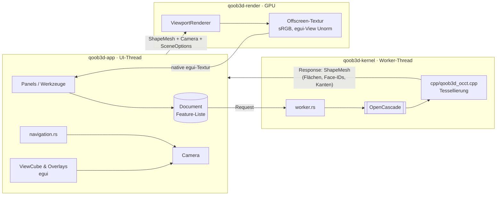
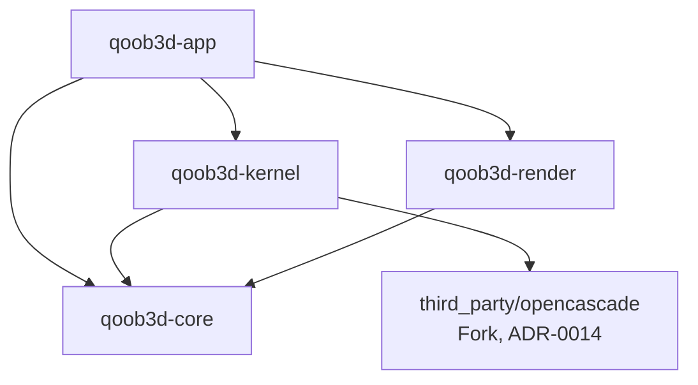

# Architektur-Überblick

Stand: M2. Details und Begründungen stehen in den ADRs (`docs/adr/`). Diese Datei zeigt das
Zusammenspiel.

## Schichten und Datenfluss

1. **Dokument** (`qoob3d-core`): die einzige Wahrheit, eine Feature-Liste mit Parametern
   (ADR-0009). Bis M3 gibt es nur die Platzhalter-Anfrage `Request::DemoPart`.
2. **Kernel** (`qoob3d-kernel`): eigener Thread, einziger Ort mit OCCT (ADR-0005). Eigene
   exception-sichere C++-Wrapper (ADR-0014) liefern `ShapeMesh`: Dreiecke mit Face-ID und
   Kanten als Polylinien.
3. **Renderer** (`qoob3d-render`): Hintergrund, Körper, Kanten (Pixel-breite Quads), Raster mit
   Druckbett und Achsen (ADR-0021). Offscreen mit MSAA, Reverse-Z; egui bekommt eine
   Unorm-View (ADR-0019).
4. **App** (`qoob3d-app`): Panels, Navigation (Fusion, Orbit um Cursor-Pivot per Raycast,
   ADR-0017; Linksziehen-Orbit, ADR-0022), ViewCube und Overlays in egui (ADR-0015),
   Kamera-Animationen. Alle Texte über Fluent (Englisch Basis, ADR-0020), gespeicherte
   `Settings`.
5. **Druckerdatenbank** (`qoob3d-core/src/printer/`): 441 Modelle, generiert aus
   OrcaSlicer-Profilen (ADR-0021).

## Threads

| Thread | Besitzt | Darf nicht |
| --- | --- | --- |
| Main/UI (winit, eframe) | egui-Context, `Viewport` (Camera, Renderer), Dokument | auf den Kernel warten |
| `qoob3d-kernel` | alle OCCT-Objekte, Rebuild-Cache | UI- oder GPU-Typen anfassen |

## Crate-Abhängigkeiten (erzwungen durch `cargo xtask check`, ADR-0003)

## Wo finde ich was?

| Thema | Ort |
| --- | --- |
| Mesh-Typen, Mesh-Prüfung, Raycast | `crates/qoob3d-core/src/mesh.rs` |
| Druckerprofile (generiert) | `crates/qoob3d-core/src/printer/{mod,data}.rs`, Generator `xtask/src/printers.rs` |
| Übersetzungen, Einstellungen | `crates/qoob3d-app/locales/*/main.ftl`, `src/{i18n,settings}.rs` |
| Kernel-Protokoll, Worker | `crates/qoob3d-kernel/src/worker.rs` |
| Eigene OCCT-Wrapper (C++) | `crates/qoob3d-kernel/cpp/`, Bridge `src/occt.rs` |
| Kamera-Mathematik (Ortho/Persp., Ray, Animation) | `crates/qoob3d-render/src/camera.rs` |
| Render-Pipelines, Targets, Farbraum | `crates/qoob3d-render/src/renderer.rs` |
| Shader (Körper, Linien, Raster) | `crates/qoob3d-render/src/shaders/scene.wgsl` |
| Headless-GPU, Readback | `crates/qoob3d-render/src/headless.rs` |
| Panels (Werkzeugleiste, Browser, Timeline) | `crates/qoob3d-app/src/panels.rs` |
| Viewport-Widget, Overlays, Navigationsleiste | `crates/qoob3d-app/src/viewport.rs` |
| ViewCube | `crates/qoob3d-app/src/viewcube.rs` |
| Maus/Trackpad → Kamera | `crates/qoob3d-app/src/navigation.rs` |
| CLI (`--render`, `--smoke-test`) | `crates/qoob3d-app/src/{cli,headless_render,smoke}.rs` |
| UI-Tests, Screenshots | `crates/qoob3d-app/tests/ui.rs` |
| Checks, Doku-Lint, Architekturregeln, Screenshots | `xtask/src/` |
