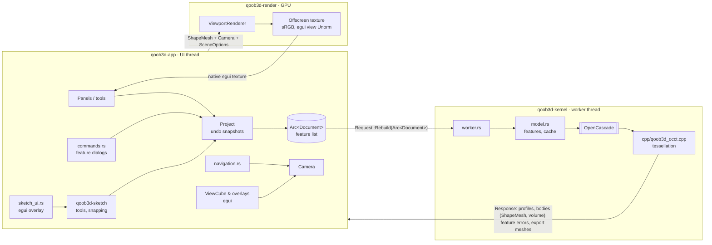

# Architecture overview

Status: M4. Details and rationale are in the ADRs (`docs/adr/`). This file shows how the parts
work together.

## Layers and data flow

1. **Document** (`qoob3d-core`): the single source of truth, a feature list with parameters
   (ADR-0030). So far there are sketches (`FeatureKind::Sketch`): points as entities, curves
   reference point IDs (ADR-0024). File = envelope `{format, format_version, document}`,
   validation and migrations on load. The document is shared immutably
   (`Arc<Document>`); every change creates a new snapshot. `Project` (app) holds
   history, undo/redo and "unsaved" (ADR-0029).
   Body features (format version 2, ADR-0031): construction plane, extrude, revolve,
   loft, spur gear and coil (ADR-0032, geometry in `core::generate`).
2. **Sketch logic** (`qoob3d-sketch`): pure tool state machines, snapping, hit testing,
   dragging, in sketch coordinates (ADR-0036). The app translates pixels ↔ plane and draws
   everything as an egui overlay (ADR-0027).
3. **Kernel** (`qoob3d-kernel`): own thread, the only place with OCCT (ADR-0005). Our own
   exception-safe C++ wrappers (ADR-0014) deliver `ShapeMesh` (triangles with face ID, edges
   as polylines) and sketch profiles via General Fuse (ADR-0028). `model.rs` builds the
   features one after another into bodies (booleans against touched bodies, hash chain cache,
   ADR-0031/0012). Rebuilds are coalesced: only the newest waiting request counts.
4. **Renderer** (`qoob3d-render`): background, bodies, edges (pixel-wide quads), grid with
   print bed and axes (ADR-0021), in sketch mode in the sketch plane. Offscreen with MSAA, reverse-Z; egui gets a
   Unorm view (ADR-0019).
5. **App** (`qoob3d-app`): panels, navigation (Fusion, orbit around cursor pivot via raycast,
   ADR-0017; left-drag orbit, ADR-0022), ViewCube and overlays in egui (ADR-0015),
   camera animations. Feature dialogs with live preview via the normal rebuild
   (ADR-0035). Export STL/3MF (ADR-0034). CLI: `--report`, `--export`, `--render` for
   `.qbd` files (ADR-0033). All texts via Fluent (English base, ADR-0020),
   saved `Settings`.
6. **Printer database** (`qoob3d-core/src/printer/`): 441 models, generated from
   OrcaSlicer profiles (ADR-0021).

## Threads

| Thread | Owns | Must not |
| --- | --- | --- |
| Main/UI (winit, eframe) | egui context, `Viewport` (Camera, Renderer), document | wait for the kernel |
| `qoob3d-kernel` | all OCCT objects, rebuild cache | touch UI or GPU types |

## Crate dependencies (enforced by `cargo xtask check`, ADR-0036)

## Where do I find what?

| Topic | Location |
| --- | --- |
| Mesh types, mesh check, raycast | `crates/qoob3d-core/src/mesh.rs` |
| Document, sketch model, planes, file format | `crates/qoob3d-core/src/document/`, fixture `crates/qoob3d-core/tests/fixtures/` |
| Expressions in input fields (`10+5`, `1in`) | `crates/qoob3d-core/src/expr.rs` |
| Profile type (regions) | `crates/qoob3d-core/src/profile.rs` |
| Sketch tools, snapping, hit testing, dragging | `crates/qoob3d-sketch/src/` |
| Profile computation (General Fuse) | `crates/qoob3d-kernel/src/profiles.rs`, `cpp/qoob3d_occt.cpp` |
| Sketch mode (overlay, HUD, plane pick) | `crates/qoob3d-app/src/sketch_ui.rs` |
| Undo/redo, load/save | `crates/qoob3d-app/src/{history,project}.rs` |
| Body features (data, validation) | `crates/qoob3d-core/src/document/feature.rs` |
| Gear involute, coil path | `crates/qoob3d-core/src/generate.rs` |
| STL/3MF writer, ZIP | `crates/qoob3d-core/src/export.rs` |
| Reference models (source) / files + expectations | `crates/qoob3d-core/src/document/examples.rs` / `models/` |
| Rebuild of the features, booleans, cache | `crates/qoob3d-kernel/src/model.rs` |
| Feature dialogs, selection in the viewport | `crates/qoob3d-app/src/commands.rs` |
| CLI batch (`--report`, `--export`) | `crates/qoob3d-app/src/batch.rs` |
| E2E modeling through the UI | `crates/qoob3d-app/tests/modeling.rs` |
| Reference model gate | `xtask/src/models.rs` |
| Printer profiles (generated) | `crates/qoob3d-core/src/printer/{mod,data}.rs`, generator `xtask/src/printers.rs` |
| Translations, settings | `crates/qoob3d-app/locales/*/main.ftl`, `src/{i18n,settings}.rs` |
| Kernel protocol, worker | `crates/qoob3d-kernel/src/worker.rs` |
| Own OCCT wrappers (C++) | `crates/qoob3d-kernel/cpp/`, bridge `src/occt.rs` |
| Camera math (ortho/persp., ray, animation) | `crates/qoob3d-render/src/camera.rs` |
| Render pipelines, targets, color space | `crates/qoob3d-render/src/renderer.rs` |
| Shaders (bodies, lines, grid) | `crates/qoob3d-render/src/shaders/scene.wgsl` |
| Headless GPU, readback | `crates/qoob3d-render/src/headless.rs` |
| Panels (toolbar, browser, timeline) | `crates/qoob3d-app/src/panels.rs` |
| Viewport widget, overlays, navigation bar | `crates/qoob3d-app/src/viewport.rs` |
| ViewCube | `crates/qoob3d-app/src/viewcube.rs` |
| Mouse/trackpad → camera | `crates/qoob3d-app/src/navigation.rs` |
| CLI (`--render`, `--smoke-test`) | `crates/qoob3d-app/src/{cli,headless_render,smoke}.rs` |
| UI tests, screenshots | `crates/qoob3d-app/tests/ui.rs` |
| Checks, docs lint, architecture rules, screenshots | `xtask/src/` |
| AI harness: guard, commit policy, hygiene, rule register, critic protocol, self-test | `xtask/src/{guard,commits,hygiene,rules,review,selftest,paths}.rs`, `harness/`, `.claude/`, `.githooks/`, `.github/workflows/` – overview `docs/harness.md` |
| Unit tests of a module | `<module>/tests.rs` next to `<module>.rs` (ADR-0039) |
