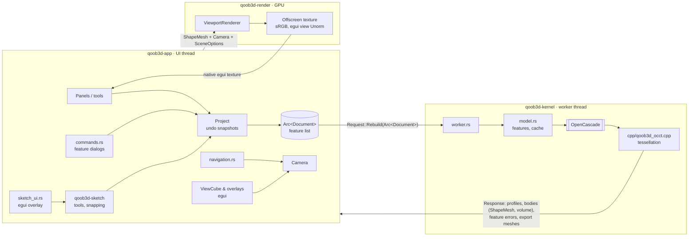
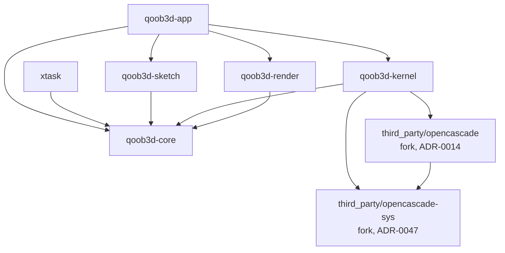

# Architecture overview

Status: M4. Details and rationale are in the ADRs (`docs/adr/`). This file shows how the parts
work together.

## Layers and data flow

1. **Document** (`qoob3d-core`): the single source of truth, a feature list with parameters
   (ADR-0030). So far there are sketches (`FeatureKind::Sketch`): points as entities, curves
   reference point IDs (ADR-0024). File = envelope `{format, format_version, document}`,
   validation and migrations on load. The document is shared immutably
   (`Arc<Document>`); every change creates a new snapshot. `Project` (app) holds
   history, undo/redo and "unsaved" (ADR-0029).
   Body features (format version 2, ADR-0031): construction plane, extrude, revolve,
   loft, spur gear and coil (ADR-0032, geometry in `core::generate`).
2. **Sketch logic** (`qoob3d-sketch`): pure tool state machines, snapping, hit testing,
   dragging, in sketch coordinates (ADR-0036). The app translates pixels ↔ plane and draws
   everything as an egui overlay (ADR-0027).
3. **Kernel** (`qoob3d-kernel`): own thread, the only place with OCCT (ADR-0005). Our own
   exception-safe C++ wrappers (ADR-0014) deliver `ShapeMesh` (triangles with face ID, edges
   as polylines) and sketch profiles via General Fuse (ADR-0028). `model.rs` builds the
   features one after another into bodies (booleans against touched bodies, hash chain cache,
   ADR-0031/0012). Rebuilds are coalesced: only the newest waiting request counts.
   `script` runs model scripts (Rhai) on the same wrappers, on the calling thread (ADR-0053).
4. **Renderer** (`qoob3d-render`): background, bodies, edges (pixel-wide quads), grid with
   print bed and axes (ADR-0021), in sketch mode in the sketch plane. Offscreen with MSAA, reverse-Z; egui gets a
   Unorm view (ADR-0019).
5. **App** (`qoob3d-app`): panels, navigation (Fusion, orbit around cursor pivot via raycast,
   ADR-0017; left-drag orbit, ADR-0022), ViewCube and overlays in egui (ADR-0015),
   camera animations. Feature dialogs with live preview via the normal rebuild
   (ADR-0035). Export STL/3MF (ADR-0034). CLI: `--report`, `--export`, `--render` for
   `.qbd` files (ADR-0033). All texts via Fluent (English base, ADR-0020),
   saved `Settings`.
   **Script projects** (ADR-0053, `docs/requirements/agent.md`): the same binary is
   `qoob3d serve <DIR>` (HTTP service on 127.0.0.1: job queue, cache index, part states),
   `qoob3d worker` (the only process that runs OCCT for project builds; JSON lines on
   stdin/stdout, killed and replaced on time or memory limit or crash) and the CLI clients
   `qoob3d build|status|export|values`. Parts are declared without OCCT (`part()` only
   records); cache entries `.qoob3d/cache/<part>/<key>.{brep,qmsh,json}` are written by the
   worker; the app (`--project`) only polls `/status` and loads changed meshes.
   The service is for local tools only (ADR-0055): a random token per start in
   `.qoob3d/service.json` is required as `X-Qoob3d-Token`, requests with an `Origin` or a
   foreign `Host` get 403 before routing; clients (`live::Client`: app, CLI, MCP,
   `render-project`) read port and token from that file, again whenever there is no answer,
   and percent-encode names in paths. A panic in a job thread fails the job with kind
   `crash`; the worker it held is replaced.
   **Tasks, checks, MCP** (ADR-0054, agent.md §4): `tasks/NNNN-slug.md` is the task inbox
   (`qoob3d-core::tasks`); the service serves it (`/tasks`, `/task/<id>`) and evaluates the
   review gate from its own part and check states (a task needs a part and a check bound,
   which the agent binds with `task_update`; load errors are reported as such; task writes
   are serialised). `checks/*.rhai` declare checks
   (`check`, `expect…`, kernel `script/check.rs`); `/check` builds stale parts and runs each
   check as one worker request; a result is stale once a part it read was rebuilt or its file
   changed. `/run` and `/measure` are worker requests that write nothing; `/save` commits
   with the `git` executable only when parts and checks are green, only project paths, and
   only when the project folder is the top level of its repository. `qoob3d mcp [DIR]` is a
   JSON-RPC 2.0 server on stdio (hand-written, synchronous): its tools forward to the
   service over HTTP as role `agent`, file tools are confined to the project folders,
   `render` runs `qoob3d render-project` in a child process and returns the PNG (several
   views as one labelled contact sheet); the script API reference, guide and examples are
   embedded in the binary, and `qoob3d init` writes the files the reference examples read
   to `lib/examples/`.
6. **Printer database** (`qoob3d-core/src/printer/`): 441 models, generated from
   OrcaSlicer profiles (ADR-0021).

## Threads

| Thread | Owns | Must not |
| --- | --- | --- |
| Main/UI (winit, eframe) | egui context, `Viewport` (Camera, Renderer), document | wait for the kernel |
| `qoob3d-kernel` | all OCCT objects, rebuild cache | touch UI or GPU types |
| `qoob3d serve`: connection threads, `qoob3d-jobs` runner, one thread per running part | jobs, part records, worker pool | run OCCT, block `/status` behind a build |
| `qoob3d worker` (process) | the OCCT shapes of one build | outlive its service (exits when stdin closes) |

## Crate dependencies (enforced by `cargo xtask check`, ADR-0036)

## Where do I find what?

| Topic | Location |
| --- | --- |
| Mesh types, mesh check, raycast | `crates/qoob3d-core/src/mesh.rs` |
| Document, sketch model, planes, file format | `crates/qoob3d-core/src/document/`, fixture `crates/qoob3d-core/tests/fixtures/` |
| Expressions in input fields (`10+5`, `1in`) | `crates/qoob3d-core/src/expr.rs` |
| Profile type (regions) | `crates/qoob3d-core/src/profile.rs` |
| Sketch tools, snapping, hit testing, dragging | `crates/qoob3d-sketch/src/` |
| Profile computation (General Fuse) | `crates/qoob3d-kernel/src/profiles.rs`, `cpp/qoob3d_occt.cpp` |
| Sketch mode (overlay, HUD, plane pick) | `crates/qoob3d-app/src/sketch_ui.rs` |
| Undo/redo, load/save | `crates/qoob3d-app/src/{history,project}.rs` |
| Body features (data, validation) | `crates/qoob3d-core/src/document/feature.rs` |
| Gear involute, coil path | `crates/qoob3d-core/src/generate.rs` |
| STL/3MF writer, ZIP | `crates/qoob3d-core/src/export.rs` |
| Reference models (source) / files + expectations | `crates/qoob3d-core/src/document/examples.rs` / `models/` |
| Rebuild of the features, booleans, cache | `crates/qoob3d-kernel/src/model.rs` |
| Feature dialogs, selection in the viewport | `crates/qoob3d-app/src/commands.rs` |
| CLI batch (`--report`, `--export`) | `crates/qoob3d-app/src/batch.rs` |
| Script project shown live (`--project`, service client, poller; W1) | `crates/qoob3d-app/src/live.rs` |
| Project service, jobs, worker pool and limits, part states (R2/R3) | `crates/qoob3d-app/src/service.rs`, `src/service/` |
| Worker process (build a part, cache entry, STEP) | `crates/qoob3d-app/src/worker.rs` |
| CLI clients `build`, `status`, `export`, `values`, `check`, `task` | `crates/qoob3d-app/src/service_cli.rs` |
| Checks, throwaway scripts, measure, save, task endpoints (R4) | `crates/qoob3d-app/src/service/{checks,probe,save,tasks}.rs`, `src/worker/probe.rs` |
| MCP server (tools, confined files, render, embedded reference and guide) | `crates/qoob3d-app/src/mcp.rs`, `src/mcp/` |
| `qoob3d init`, `qoob3d render-project`, contact sheet | `crates/qoob3d-app/src/{init,project_render}.rs`, `src/project_render/sheet.rs` |
| Task inbox (files, roles, binding, review gate) | `crates/qoob3d-core/src/tasks/` |
| Atomic file write (temp file + rename) | `crates/qoob3d-core/src/fs.rs` |
| `check`/`expect…` in scripts, measures of shapes from Rust | `crates/qoob3d-kernel/src/script/{check,measure}.rs` |
| Project folder, values, build graph, cache key | `crates/qoob3d-core/src/project/` |
| Mesh transfer format, STL import | `crates/qoob3d-core/src/{qmesh,stl}.rs` |
| E2E modeling through the UI | `crates/qoob3d-app/tests/modeling.rs` |
| Reference model gate | `xtask/src/models.rs` |
| Printer profiles (generated) | `crates/qoob3d-core/src/printer/{mod,data}.rs`, generator `xtask/src/printers.rs` |
| Translations, settings | `crates/qoob3d-app/locales/*/main.ftl`, `src/{i18n,settings}.rs` |
| Kernel protocol, worker | `crates/qoob3d-kernel/src/worker.rs` |
| Own OCCT wrappers (C++) | `crates/qoob3d-kernel/cpp/`, bridge `src/occt.rs` |
| Script kernel: Rhai CAD API, sandbox, errors, STEP/STL/3MF export (ADR-0053) | `crates/qoob3d-kernel/src/script.rs`, `src/script/`, reference `docs/script-api.md` |
| Camera math (ortho/persp., ray, animation) | `crates/qoob3d-render/src/camera.rs` |
| Render pipelines, targets, color space | `crates/qoob3d-render/src/renderer.rs` |
| Shaders (bodies, lines, grid) | `crates/qoob3d-render/src/shaders/scene.wgsl` |
| Headless GPU, readback | `crates/qoob3d-render/src/headless.rs` |
| Panels (toolbar, browser, timeline) | `crates/qoob3d-app/src/panels.rs` |
| Viewport widget, overlays, navigation bar | `crates/qoob3d-app/src/viewport.rs` |
| ViewCube | `crates/qoob3d-app/src/viewcube.rs` |
| Mouse/trackpad → camera | `crates/qoob3d-app/src/navigation.rs` |
| CLI (`--render`, `--smoke-test`) | `crates/qoob3d-app/src/{cli,headless_render,smoke}.rs` |
| UI tests, screenshots | `crates/qoob3d-app/tests/ui.rs` |
| Checks, docs lint, architecture rules, screenshots | `xtask/src/` |
| AI harness: guard, commit policy, hygiene, rule register, critic protocol, self-test | `xtask/src/{guard,commits,hygiene,rules,review,selftest,paths,worktree}.rs`, `harness/`, `.claude/`, `.githooks/`, `.github/workflows/` – overview `docs/harness.md` |
| Unit tests of a module | `<module>/tests.rs` next to `<module>.rs` (ADR-0039) |
