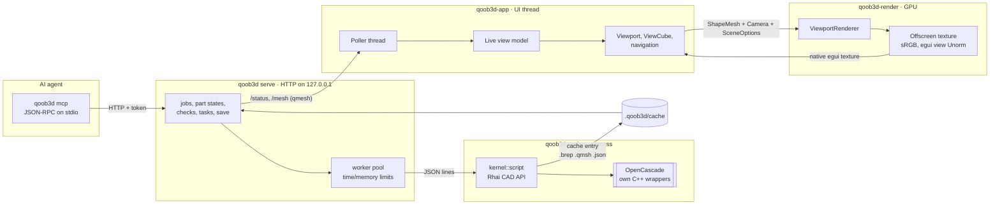
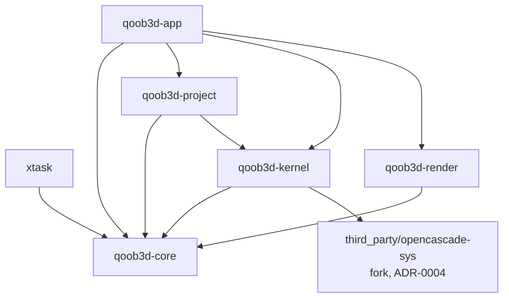

# Architecture overview

Status: script projects only (cleanup 2026-11). Details and rationale are in the ADRs
(`docs/adr/`). This file shows how the parts work together.

A model is a project folder (`qoob3d.toml`, `parts/*.rhai`, `checks/*.rhai`, `values/`,
`tasks/`) in Git. An AI agent edits it over MCP, the service builds it in worker processes,
and the app shows the built parts live (ADR-0053, ADR-0054).

## Layers and data flow

1. **Core** (`qoob3d-core`): plain data shared by everyone: `ShapeMesh` (triangles with face
   ID, edges as polylines), the mesh check `MeshReport` (watertight, volume), STL/3MF writers
   (ADR-0034), the indexed mesh transfer format `qmesh`, the project folder (values, build
   graph, cache key), the task inbox and the printer database (441 models generated from
   OrcaSlicer profiles, ADR-0021).
2. **Kernel** (`qoob3d-kernel`): the only place with OCCT. Our own exception-safe C++ wrappers
   on the `opencascade-sys` fork (ADR-0004). `script` runs model scripts (Rhai) on the calling
   thread: primitives, batched booleans with a plausibility rule, profiles and profile
   algebra, pipes, fillets, shells, measures, checks, STEP export (ADR-0053). `tessellate`
   turns shapes into `ShapeMesh`. STL and 3MF are written by the service from the cached
   meshes (ADR-0034).
3. **Service and workers** (`qoob3d-project`; the binary `qoob3d` of `qoob3d-app` dispatches
   to it): `qoob3d serve <DIR>` is an HTTP
   service on 127.0.0.1 with a job queue, cache index and part states. `qoob3d worker` is the
   only process that runs OCCT for project builds (JSON lines on stdin/stdout, killed and
   replaced on time or memory limit or crash). Parts are declared without OCCT (`part()`
   only records), and in a worker too: the service never evaluates a script (ADR-0055);
   `/status` answers from the last known declarations and lists files that do not load per
   file. Cache entries `.qoob3d/cache/<part>/<key>.{brep,qmsh,json}` are written by the
   worker and carry whether the mesh is watertight.
   The service is for local tools only (ADR-0055): a random token per start in
   `.qoob3d/service.json` is required as `X-Qoob3d-Token`, requests with an `Origin` or a
   foreign `Host` get 403 before routing; clients (`client::Client`: app, CLI, MCP,
   `render-project`) read port and token from that file, again whenever there is no answer,
   and percent-encode names in paths. A panic in a job thread fails the job with kind
   `crash`; the worker it held is replaced.
4. **Tasks, checks, MCP** (ADR-0054, `docs/requirements/agent.md` §4): `tasks/NNNN-slug.md`
   is the task inbox; the service serves it (`/tasks`, `/task/<id>`) and evaluates the review
   gate from its own part and check states (a task needs a part and a check bound, which the
   agent binds with `task_update`; load errors are reported as such; task writes are
   serialised). `checks/*.rhai` declare checks (`check`, `expect…`); `/check` builds stale
   parts and runs each check as one worker request; a result is stale once a part it read was
   rebuilt or its file changed. `/run` and `/measure` are worker requests that write nothing;
   `/save` commits with the `git` executable only when parts and checks are green, only
   project paths, and only when the project folder is the top level of its repository.
   `qoob3d mcp [DIR]` is a JSON-RPC 2.0 server on stdio (hand-written, synchronous): its tools
   forward to the service over HTTP as role `agent`, file tools are confined to the project
   folders, `render` runs `qoob3d render-project` in a child process and returns the PNG
   (several views as one labelled contact sheet); the script API reference, guide and
   examples are embedded in the binary, and `qoob3d init` writes the files the reference
   examples read to `lib/examples/`.
5. **App** (`qoob3d-app`): opens a project (`--project`, folder dialog, Cmd/Ctrl+O), starts
   the service if needed, and a `Poller` thread polls `/status` and loads changed meshes
   (`docs/requirements/project-app.md`). Without a project it shows an empty state. Panels
   (toolbar, browser with the parts), navigation (Fusion, orbit around cursor pivot via
   raycast, left-drag orbit; ADR-0008), ViewCube and overlays in egui (ADR-0019),
   camera animations. All texts via Fluent (English base, ADR-0020), saved `Settings`.
6. **Renderer** (`qoob3d-render`): background, bodies, edges (pixel-wide quads), grid with
   print bed and axes (ADR-0021). Offscreen with MSAA, reverse-Z; egui gets a Unorm view
   (ADR-0019). Headless for `render-project`.

## Threads and processes

| Thread / process | Owns | Must not |
| --- | --- | --- |
| App main/UI (winit, eframe) | egui context, `Viewport` (Camera, Renderer), `Live` | do HTTP or wait for the service |
| App `Poller` thread | the service client | touch UI or GPU types |
| `qoob3d serve`: connection threads, `qoob3d-jobs` runner, one thread per running part | jobs, part records, worker pool | run OCCT, block `/status` behind a build |
| `qoob3d worker` (process) | the OCCT shapes of one build | outlive its service (exits when stdin closes) |

## Crate dependencies (enforced by `cargo xtask check`, ADR-0036)

## Where do I find what?

| Topic | Location |
| --- | --- |
| Mesh types, mesh check, raycast | `crates/qoob3d-core/src/mesh.rs` |
| STL/3MF writer, ZIP (used by the service's export, ADR-0034) | `crates/qoob3d-core/src/export.rs` |
| Mesh transfer format | `crates/qoob3d-core/src/qmesh.rs` |
| Project folder, values, build graph, cache key | `crates/qoob3d-core/src/project/` |
| Task inbox (files, roles, binding, review gate) | `crates/qoob3d-core/src/tasks/` |
| Atomic file write (temp file + rename) | `crates/qoob3d-core/src/fs.rs` |
| Printer profiles (generated) | `crates/qoob3d-core/src/printer/{mod,data}.rs`, generator `xtask/src/printers.rs` |
| Script kernel: Rhai CAD API, sandbox, errors, STEP export (ADR-0053) | `crates/qoob3d-kernel/src/script.rs`, `src/script/`, reference `docs/script-api.md` |
| `check`/`expect…` in scripts, measures of shapes from Rust | `crates/qoob3d-kernel/src/script/{check,measure}.rs` |
| Own OCCT wrappers (C++), tessellation | `crates/qoob3d-kernel/cpp/`, bridge `src/occt.rs`, `src/tessellate.rs` |
| Project service, jobs, worker pool and limits, part states | `crates/qoob3d-project/src/service.rs`, `src/service/` |
| Worker process (build a part, cache entry, STEP) | `crates/qoob3d-project/src/worker.rs` |
| Checks, throwaway scripts, measure, save, task endpoints | `crates/qoob3d-project/src/service/{checks,probe,save,tasks}.rs`, `src/worker/probe.rs` |
| Service client (project folder, token, HTTP) | `crates/qoob3d-project/src/client.rs` |
| CLI clients `build`, `status`, `export`, `values`, `check`, `task` | `crates/qoob3d-app/src/service_cli.rs` |
| MCP server (tools, confined files, render, embedded reference and guide) | `crates/qoob3d-project/src/mcp.rs`, `src/mcp/` |
| `qoob3d init` | `crates/qoob3d-project/src/init.rs` |
| `qoob3d render-project`, contact sheet | `crates/qoob3d-app/src/project_render.rs`, `src/project_render/sheet.rs` |
| Script project shown live (poller, view model) | `crates/qoob3d-app/src/live.rs` |
| App, panels (toolbar, browser, empty state) | `crates/qoob3d-app/src/{app,panels}.rs` |
| Viewport widget, overlays, navigation bar | `crates/qoob3d-app/src/viewport.rs` |
| ViewCube | `crates/qoob3d-app/src/viewcube.rs` |
| Mouse/trackpad → camera | `crates/qoob3d-app/src/navigation.rs` |
| Translations, settings | `crates/qoob3d-app/locales/*/main.ftl`, `src/{i18n,settings}.rs` |
| Smoke test, headless render | `crates/qoob3d-app/src/{smoke,headless_render}.rs` |
| UI tests, screenshots | `crates/qoob3d-app/tests/ui.rs`, `tests/project.rs` |
| Camera math (ortho/persp., ray, animation) | `crates/qoob3d-render/src/camera.rs` |
| Render pipelines, targets, color space | `crates/qoob3d-render/src/renderer.rs` |
| Shaders (bodies, lines, grid) | `crates/qoob3d-render/src/shaders/scene.wgsl` |
| Headless GPU, readback | `crates/qoob3d-render/src/headless.rs` |
| Reference project (gate) | `models/`, `xtask/src/models.rs` |
| Checks, docs lint, architecture rules, screenshots | `xtask/src/` |
| AI harness: write protection for harness files, commit policy, hygiene, self-test | `.claude/hooks/guard.sh`, `xtask/src/{commits,hygiene,selftest,paths}.rs`, `harness/`, `.claude/`, `.githooks/`, `.github/workflows/` – overview `docs/harness.md` |
| Unit tests of a module | `<module>/tests.rs` next to `<module>.rs` (ADR-0037) |
