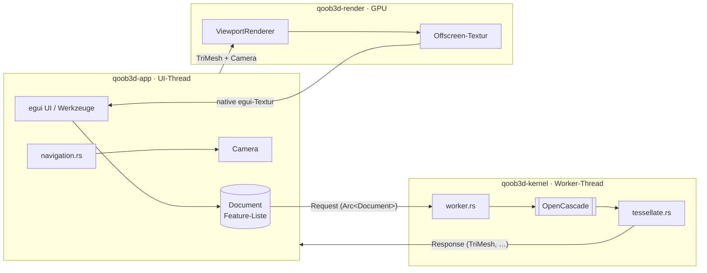
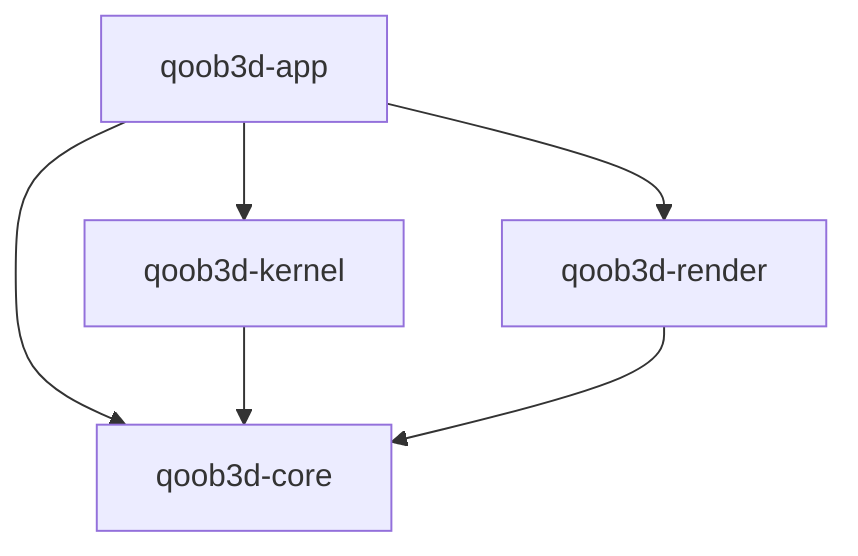

# Architektur-Überblick

Stand: M1. Die Details und Begründungen stehen in den ADRs (`docs/adr/`). Diese Datei
zeigt das Zusammenspiel.

## Schichten und Datenfluss

1. **Dokument** (`qoob3d-core`): die einzige Wahrheit, eine Feature-Liste mit Parametern
   (ADR-0009). Aktuell (M1) gibt es noch kein Dokument, sondern nur `Request::DemoCube`.
2. **Kernel** (`qoob3d-kernel`): ein eigener Thread, der als einziger OCCT anfasst
   (ADR-0005). Er bekommt Anfragen mit reinen Daten und liefert `TriMesh` und Status zurück.
3. **Renderer** (`qoob3d-render`): zeichnet `TriMesh` und Camera offscreen (ADR-0007).
4. **App** (`qoob3d-app`): verbindet alles, übersetzt Eingaben in Kamera- und
   Dokumentänderungen und verwirft veraltete Kernel-Antworten anhand der `RequestId`.

## Threads

| Thread | Besitzt | Darf nicht |
| --- | --- | --- |
| Main/UI (winit, eframe) | egui-Context, `Document`, `Camera`, `ViewportRenderer`, wgpu-Device | auf den Kernel warten |
| `qoob3d-kernel` | alle OCCT-Objekte, Rebuild-Cache | UI- oder GPU-Typen anfassen |

## Crate-Abhängigkeiten (erzwungen durch `cargo xtask check`, ADR-0003)

## Wo finde ich was?

| Thema | Ort |
| --- | --- |
| Mesh-Typ, Bounding-Box, Mesh-Prüfung | `crates/qoob3d-core/src/mesh.rs` |
| Kernel-Protokoll, Worker | `crates/qoob3d-kernel/src/worker.rs` |
| OCCT → TriMesh | `crates/qoob3d-kernel/src/tessellate.rs` |
| Kamera-Mathematik | `crates/qoob3d-render/src/camera.rs` |
| Render-Pipelines, Targets | `crates/qoob3d-render/src/renderer.rs`, `shaders/scene.wgsl` |
| Headless-GPU, Readback | `crates/qoob3d-render/src/headless.rs` |
| Maus/Trackpad → Kamera | `crates/qoob3d-app/src/navigation.rs` |
| CLI (`--render`, `--smoke-test`) | `crates/qoob3d-app/src/cli.rs`, `smoke.rs` |
| Checks, Doku-Lint, Architekturregeln | `xtask/src/` |
