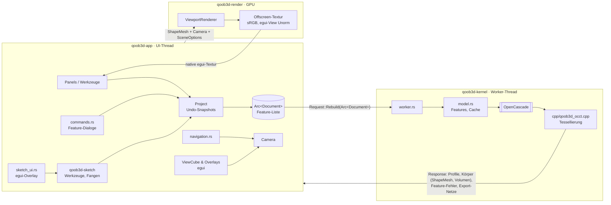
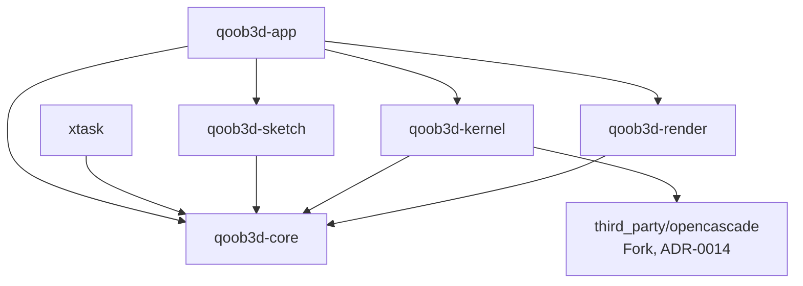

# Architektur-Überblick

Stand: M4. Details und Begründungen stehen in den ADRs (`docs/adr/`). Diese Datei zeigt das
Zusammenspiel.

## Schichten und Datenfluss

1. **Dokument** (`qoob3d-core`): die einzige Wahrheit, eine Feature-Liste mit Parametern
   (ADR-0030). Bisher gibt es Skizzen (`FeatureKind::Sketch`): Punkte als Entitäten, Kurven
   referenzieren Punkt-IDs (ADR-0024). Datei = Hülle `{format, format_version, document}`,
   Validierung und Migrationen beim Laden. Das Dokument ist unveränderlich geteilt
   (`Arc<Document>`); jede Änderung erzeugt einen neuen Schnappschuss. `Project` (App) hält
   Verlauf, Undo/Redo und „ungespeichert“ (ADR-0029).
   Körper-Features (Formatversion 2, ADR-0031): Konstruktionsebene, Extrudieren, Drehen,
   Erhebung, Stirnrad und Spirale (ADR-0032, Geometrie in `core::generate`).
2. **Skizzenlogik** (`qoob3d-sketch`): reine Werkzeug-Zustandsautomaten, Fangen, Treffertest,
   Ziehen, in Skizzenkoordinaten (ADR-0036). Die App übersetzt Pixel ↔ Ebene und zeichnet
   alles als egui-Overlay (ADR-0027).
3. **Kernel** (`qoob3d-kernel`): eigener Thread, einziger Ort mit OCCT (ADR-0005). Eigene
   exception-sichere C++-Wrapper (ADR-0014) liefern `ShapeMesh` (Dreiecke mit Face-ID, Kanten
   als Polylinien) und Skizzenprofile per General Fuse (ADR-0028). `model.rs` baut die
   Features nacheinander zu Körpern (Booleans gegen berührte Körper, Hash-Ketten-Cache,
   ADR-0031/0012). Rebuilds werden zusammengefasst: nur die neueste wartende Anfrage zählt.
4. **Renderer** (`qoob3d-render`): Hintergrund, Körper, Kanten (Pixel-breite Quads), Raster mit
   Druckbett und Achsen (ADR-0021), im Skizziermodus in der Skizzenebene. Offscreen mit MSAA, Reverse-Z; egui bekommt eine
   Unorm-View (ADR-0019).
5. **App** (`qoob3d-app`): Panels, Navigation (Fusion, Orbit um Cursor-Pivot per Raycast,
   ADR-0017; Linksziehen-Orbit, ADR-0022), ViewCube und Overlays in egui (ADR-0015),
   Kamera-Animationen. Feature-Dialoge mit Live-Vorschau über den normalen Rebuild
   (ADR-0035). Export STL/3MF (ADR-0034). CLI: `--report`, `--export`, `--render` für
   `.qbd`-Dateien (ADR-0033). Alle Texte über Fluent (Englisch Basis, ADR-0020),
   gespeicherte `Settings`.
6. **Druckerdatenbank** (`qoob3d-core/src/printer/`): 441 Modelle, generiert aus
   OrcaSlicer-Profilen (ADR-0021).

## Threads

| Thread | Besitzt | Darf nicht |
| --- | --- | --- |
| Main/UI (winit, eframe) | egui-Context, `Viewport` (Camera, Renderer), Dokument | auf den Kernel warten |
| `qoob3d-kernel` | alle OCCT-Objekte, Rebuild-Cache | UI- oder GPU-Typen anfassen |

## Crate-Abhängigkeiten (erzwungen durch `cargo xtask check`, ADR-0036)

## Wo finde ich was?

| Thema | Ort |
| --- | --- |
| Mesh-Typen, Mesh-Prüfung, Raycast | `crates/qoob3d-core/src/mesh.rs` |
| Dokument, Skizzenmodell, Ebenen, Dateiformat | `crates/qoob3d-core/src/document/`, Fixture `crates/qoob3d-core/tests/fixtures/` |
| Ausdrücke in Eingabefeldern (`10+5`, `1in`) | `crates/qoob3d-core/src/expr.rs` |
| Profil-Typ (Regionen) | `crates/qoob3d-core/src/profile.rs` |
| Skizzenwerkzeuge, Fangen, Treffertest, Ziehen | `crates/qoob3d-sketch/src/` |
| Profilberechnung (General Fuse) | `crates/qoob3d-kernel/src/profiles.rs`, `cpp/qoob3d_occt.cpp` |
| Skizziermodus (Overlay, HUD, Ebenenwahl) | `crates/qoob3d-app/src/sketch_ui.rs` |
| Undo/Redo, Laden/Speichern | `crates/qoob3d-app/src/{history,project}.rs` |
| Körper-Features (Daten, Validierung) | `crates/qoob3d-core/src/document/feature.rs` |
| Zahnrad-Evolvente, Spiralbahn | `crates/qoob3d-core/src/generate.rs` |
| STL/3MF-Writer, ZIP | `crates/qoob3d-core/src/export.rs` |
| Referenzmodelle (Quelle) / Dateien + Erwartungen | `crates/qoob3d-core/src/document/examples.rs` / `models/` |
| Rebuild der Features, Booleans, Cache | `crates/qoob3d-kernel/src/model.rs` |
| Feature-Dialoge, Auswahl im Viewport | `crates/qoob3d-app/src/commands.rs` |
| CLI-Batch (`--report`, `--export`) | `crates/qoob3d-app/src/batch.rs` |
| E2E-Modellieren durch die UI | `crates/qoob3d-app/tests/modeling.rs` |
| Referenzmodell-Gate | `xtask/src/models.rs` |
| Druckerprofile (generiert) | `crates/qoob3d-core/src/printer/{mod,data}.rs`, Generator `xtask/src/printers.rs` |
| Übersetzungen, Einstellungen | `crates/qoob3d-app/locales/*/main.ftl`, `src/{i18n,settings}.rs` |
| Kernel-Protokoll, Worker | `crates/qoob3d-kernel/src/worker.rs` |
| Eigene OCCT-Wrapper (C++) | `crates/qoob3d-kernel/cpp/`, Bridge `src/occt.rs` |
| Kamera-Mathematik (Ortho/Persp., Ray, Animation) | `crates/qoob3d-render/src/camera.rs` |
| Render-Pipelines, Targets, Farbraum | `crates/qoob3d-render/src/renderer.rs` |
| Shader (Körper, Linien, Raster) | `crates/qoob3d-render/src/shaders/scene.wgsl` |
| Headless-GPU, Readback | `crates/qoob3d-render/src/headless.rs` |
| Panels (Werkzeugleiste, Browser, Timeline) | `crates/qoob3d-app/src/panels.rs` |
| Viewport-Widget, Overlays, Navigationsleiste | `crates/qoob3d-app/src/viewport.rs` |
| ViewCube | `crates/qoob3d-app/src/viewcube.rs` |
| Maus/Trackpad → Kamera | `crates/qoob3d-app/src/navigation.rs` |
| CLI (`--render`, `--smoke-test`) | `crates/qoob3d-app/src/{cli,headless_render,smoke}.rs` |
| UI-Tests, Screenshots | `crates/qoob3d-app/tests/ui.rs` |
| Checks, Doku-Lint, Architekturregeln, Screenshots | `xtask/src/` |
