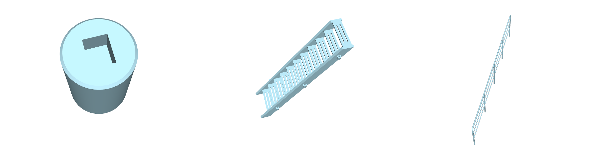

# M0 report: feasibility of build123d / build123d-mcp

> English translation; German original in Git history (commit 43c7bc3). Measured with
> Python/build123d before the decision for an all-Rust core (ADR-0053).
>
> **Note of 2026-11-22:** the Python probe scripts (`werft/m0/*.py`) and the raw JSON data
> (`m0/*.json`) named below were removed from the working tree because the repository is
> English (ADR-0045) and the architecture moved to Rust (ADR-0053). They remain in Git history
> (last present in commit 82e4ec6). The analytic volume formulas live on in
> `crates/qoob3d-kernel/tests/script_m0.rs`.
>
> Translation notes: the concept is [`werft-concept.md`](werft-concept.md) (originally
> `werft/docs/konzept.md`). The raw data and the image moved with this report and are linked
> relative to it (`m0/…` = `docs/concept/m0/…`, originally `werft/docs/m0/…`); the scripts
> stayed in `werft/m0/`. German tool and identifier names are kept, with an English gloss
> where they first appear.

As of 2026-11-22. Basis: [`werft-concept.md`](werft-concept.md), section 8 (M0).
All numbers come from runs in this repository; the raw data are in
`m0/*.json` (next to this report), the scripts in `werft/m0/`.

**Important up front – measuring machine:** the measurements were taken in a Linux container
(x86_64, 4 cores, 15 GB RAM, Python 3.12.3), **not** on your Mac with
Apple Silicon. The times are therefore guide values. To repeat on the Mac (from `werft/`):
`uv run python m0/hole_step.py && uv run python m0/messen.py --wdh 5`.

Versions: build123d 0.13.0, OCP 8.0.1.1 (**OCCT 8.0.1**), build123d-mcp 0.3.91.

## 1. Acceptance M0 – result

Every measurement runs in a freshly started worker process (spawn) with a
hard time limit (120 s); the main process never imports build123d.
5 repetitions, the median is given (maximum in parentheses).

| Criterion | Target | Measured | Met |
|---|---|---|---|
| All three parts are produced | yes | yes, all valid (`is_valid`), stair and crane column 1 body each, railing 6 wire bodies or 1 fused one | yes |
| Volume < 1 % against section 10 | < 1 % | Stair **−19.5 %** against Fusion; not checkable, see 1.1 | **no / not checkable** |
| Volume against the analytic formula of the same geometry | – | Crane column 0.000 %, stair 0.000 %, railing 0.000 % (deviation < 1e-12) | yes |
| Build time per part | < 5 s | Crane column 0.013 s (0.018), stair 0.675 s (0.723), railing 0.028 s (0.029), railing fused 0.150 s (0.164) | yes |
| STEP import | < 60 s | NIST CTC 02 (1.15 MB, 664 faces): 0.42 s (0.45); hull GPPH (0.35 MB, 17 B-spline faces): 0.23 s (0.26); synthetic 10 × CTC 02 (35.9 MB, 6,640 faces): 6.11 s (6.15) | yes |
| STEP from the cache | < 2 s | Read BREP: 0.015 s / 0.007 s / 0.154 s | yes |
| Distance, interference, ray onto a face | measure | all three measured on all three STEP bodies, see 1.3 | yes |

**In addition, what the criteria do not cover:** `import build123d` costs
**1.62–1.74 s** in every new process (median over all runs). A whole
process run for one part therefore takes 2.1–3.5 s, although building itself needs only
0.01–0.7 s. Consequence for the architecture: section 2.2 demands "every run
in its own process". That works only with **pre-warmed worker processes** that
have build123d already loaded, otherwise every mouse action (7a) costs at least 1.7 s.

### 1.1 Assumption of the concept that does not hold: "volume < 1 % against section 10"

Section 10 does not define the geometry completely. For the stair, the
tread depth, tread thickness, slot length, position and size of the stanchion eyes and the
reading of "stringer 1.6 × 5 mm" (5 mm across the inclination or vertical) are missing. I
set these dimensions as `ANNAHME` (assumption; `werft/m0/teile.py`, every constant is marked)
and arrive at 1,955.32 mm³ instead of 2,428.5 mm³ (**−19.5 %**). By turning the
free dimensions any number could be reached; that would not be evidence but
fitting.

For the railing the comparison values contradict themselves: 2.8 m Ø 0.8 and
2.4 m Ø 0.5 give, by circle area × length, 1.878 cm³; stated are 1.841 cm³
(+2.0 %). "Around" 2.8 m is too imprecise for a 1 % check. For the crane column
section 10 itself names no volume.

**Proposal:**
1. I check the accuracy of the kernel against an **analytic formula
   of the same geometry** (`*_soll_volumen`, i.e. target volume, in `werft/m0/teile.py`).
   Result: deviation 0.000 % for all three parts. That is the actual statement "the kernel
   computes correctly".
2. For the comparison with Fusion, **export the Fusion bodies as STEP**
   (stair, crane column, eight wires). Werft then compares shape against shape:
   volume, bounding box and largest deviation, instead of only one sum figure. That is
   also the core of the later tool `vergleich` (compare). Until the STEP files
   are available, the criterion counts as **not checkable**, not as met.

### 1.2 Build times in detail

| Part | Faces | Build cold | Build warm | Check (`is_valid` + volume) | whole process |
|---|---|---|---|---|---|
| Crane column | 13 | 0.013 s | 0.009 s | 0.002 s | 2.14 s |
| Stair | 170 | 0.675 s | 0.625 s | 0.032 s | 3.48 s |
| Railing (6 bodies) | 22 | 0.028 s | 0.021 s | 0.003 s | 2.22 s |
| Railing fused | 21 | 0.150 s | 0.139 s | 0.019 s | 2.54 s |

Export (measured once): STEP 0.007–0.048 s, STL 0.009–0.10 s, 3MF
0.03–0.36 s. All STL and 3MF files are watertight. I checked that independently with
trimesh and lib3mf, the archives additionally with `unzip -t`. The
mesh volume deviates 0.0005–0.045 % from the BREP volume
(tessellation tolerance 0.01 mm).

### 1.3 STEP bodies: import, cache, measurements

**Substitute noted:** a STEP export of the ship hull is not available. As
substitutes serve (`werft/m0/hole_step.py` downloads them, checksums there):
- **NIST CTC 02**, a public test part of the US agency NIST: 1.15 MB,
  664 faces, 94 of them B-spline;
- **GPPH hull** from the public repository crayon-party/Hull-GNN: a real
  ship hull with 17 B-spline faces, 12.07 m long;
- **synthetic**: 10 shifted copies of CTC 02 in one file, 35.9 MB,
  6,640 faces, as a load test.

| | CTC 02 | Hull | 10 × CTC 02 |
|---|---|---|---|
| Read STEP | 0.420 s | 0.230 s | 6.113 s |
| Write BREP (cache) | 0.031 s | 0.021 s | 0.420 s |
| Read BREP (cache) | 0.015 s | 0.007 s | 0.154 s |
| Size of BREP | 1.46 MB | 1.19 MB | 15.8 MB |
| Distance to neighbouring box | 0.032 s → 104.202 mm | 0.157 s → 558.091 mm | 0.074 s → 157.629 mm |
| Interference (boolean intersection with an obstructing box) | 0.088 s, 222,781 mm³ | 0.128 s, 8.80e8 mm³ | 0.862 s, 4.34e7 mm³ |
| Ray from above, hits on faces | 0.012 s, 2 hits | 0.027 s, 2 hits (deck z = 1658.607, bottom z = 0.000) | 0.022 s, 0 hits (ray in the gap between copies, correct) |

**Verified independently:** I additionally re-measured the distance on a mesh with
a dense sample (trimesh + scipy, no OCCT). Result
104.491 mm instead of 104.202 mm (+0.28 %) and 559.284 mm instead of 558.091 mm (+0.21 %).
A sample can only overestimate the distance, so the values fit. All
volumes after reading from the cache are bit-exactly equal to those after
the STEP import (deviation < 1e-12 relative).

## 2. build123d-mcp: what it can do

Tried out via a real MCP client (`werft/m0/mcp_probe.py`, log in
`m0/m0_mcp_probe.json`, tool list in `werft/m0/mcp_tools.txt`). The server
starts and reports in 0.55 s, offers **48 tools**.

Demonstrably working:
- `execute`: free build123d code in a persistent session. The code runs
  in a worker process with a sandbox (AST check, import allowlist) and
  time limit (`--exec-timeout`). Crane column built in 1.67 s including
  session setup.
- `measure` (0.01 s), `validate` (0.04 s, "Validity gate: PASS" including the
  watertightness check), `analyze_printability` (0.02 s: for the crane column it correctly
  reports the 100.5 mm² horizontal underside next to the peg as an
  overhang), `cross_sections`, `compare` (fit/align/shape/snapshot),
  feature recognition (holes, bosses, counterbores), snapshots.
- `render_view`: PNG headless via VTK in 2.4–3.2 s, with section plane
  (`clip_plane`), colors and highlights.
- `export`: STEP, STL, **3MF**, DXF, SVG (2.29 s for the crane column as STEP).
- `import_cad_file`: CTC 02 in 0.90 s.
- Live viewer: meshes go as glb via a Unix socket to a
  viewer application (`viewer.py`). That is interesting for the app.
- Ready-made instructions for agents (`install_skill`, cookbooks for selectors).

Observed weaknesses:
- **The service blocks during a computation.** Measurement: during an
  endless loop in `execute`, `health_check` answered only after **13.30 s**,
  namely only after the abort at the time limit (15 s). All tool calls
  run through a lock on a single session. Exactly that is
  Fusion problem 2 from section 2.2.
- **A timeout in the parent process kills the whole session.** That
  is stated in the source code (`worker.py`, comment on issue #214: "a timeout here kills
  the worker and destroys all session state"). In the experiment the session
  survived because the Python loop was interruptible by SIGALRM; a
  hanging OCCT computation in C++ is not.
- **Memory limit ineffective on the Mac**: `RLIMIT_DATA` is, under macOS,
  a "documented no-op" according to its own source comment.
- The default iso view of `render_view` did not show the pocket at the top of the
  crane column; with explicitly set `azimuth`/`elevation` it was
  visible (`m0/probe-parts.png`). I have not clarified the cause.
  Conclusion: Werft renders only with fixed, named cameras.
- Size and pace: around 21,800 lines in version 0.3.x, much of it for
  drawings (non-goal). Answers are mixed text and JSON.

## 3. What is missing compared with sections 6, 6a and 7a

| Concept | build123d-mcp | Gap |
|---|---|---|
| `projekt_status` (project status) | `session_state` (only the session) | Project folder, Git state, jobs are missing |
| `bauen(teile, warten_s)` (build) | – | Project with `parts/*.py`, build graph and cache are missing entirely |
| `auftrag(id, …)` (job) | – | No background jobs; calls block (13.3 s measured) |
| `ausfuehren(code)` (execute) | `execute` | present, but a session with state instead of a throwaway session |
| `messen(abstand/durchdringung/strahl/masse/huelle)` (measure: distance/interference/ray/dimensions/bounding box) | `measure`, `compare(kind="fit")`, `clearance()` in code | Ray is missing as a tool |
| `rendern(…)` (render) | `render_view` | present; named views (`views.toml`) are missing |
| `foto_abgleich` (photo matching) | – | missing |
| `pruefen` (check; pytest) | `validate`, `inspect_part` | pytest checks of the project are missing |
| `druck_analyse` (print analysis) | `analyze_printability` | largely present (overhang, wall, bed) |
| `vergleich(stand_a, stand_b)` (compare two states) | `compare(kind="shape")` in the session | Comparison of two Git states is missing |
| `export(…, drucklage)` (print orientation) | `export` incl. 3MF | Print orientation is missing |
| `anmerkungen`, `stand_sichern` (annotations, save state) | – | missing |
| Answer format `{ok, dauer_s, warnungen, ergebnis}` (ok, duration_s, warnings, result) | mixed | missing |
| 6a image measurement (all 8 building blocks) | – | missing completely, no OpenCV |
| 7a mouse operation | Live viewer only for viewing | missing completely |

## 4. Recommendation: **only a model** for the core, besides that use it unchanged

Rationale:
1. The load-bearing demands from sections 2.2 and 4 contradict the structure
   of build123d-mcp: one session with state and a lock instead of jobs and
   a queue (measured: blocked for 13.3 s), session loss on
   timeout, no project, no build graph, no cache. Retrofitting
   that would mean rebuilding the core. "Extending" would thus be a fork of
   21,800 lines in a version 0.3 that moves fast. That contradicts
   priority (a), the small effort.
2. What Werft really needs new (werftd, build graph, cache, jobs, project)
   is manageable. The geometry is done by build123d anyway.
3. We explicitly adopt good ideas: worker process plus sandbox with
   import allowlist, validity gate before the export, repair hints
   in error messages, glb stream for the viewer, print analysis.
4. **Using it unchanged** is sensible nevertheless: as a second MCP server
   next to the Werft server, the agent can already sketch freely,
   render and measure with it today. That costs nothing. But Werft does not call
   build123d-mcp internally.

Fallback: if our own print analysis or our own rendering turns out to be expensive,
the functions of build123d-mcp (Apache-2.0) can be called as a **library** in
our worker processes, not as a server.

## 5. Weaknesses found in the geometry kernel

Probe: `werft/m0/schwaechen.py`, data in `m0/m0_schwaechen.json`. Every case
runs in its own process with a 90 s limit.

| Case | Result | Assessment |
|---|---|---|
| Fillet all 24 edges of the crane column, r = 0.2 | valid | good |
| Fillet the intersection edges of the fused railing (26 edges, r = 0.15) | valid | good, better than expected |
| Fillet the tread edges of the stair (r = 0.2) | **error** "Failed creating a fillet … try a smaller value" | The message does not name the offending edge |
| Shell of the freeform hull (STEP), deck open, wall 20 mm | **error** "offset Error" with all three offset kinds | Shell on freeform fails |
| Shell of a loft hull (elliptical frames), wall 1.2 mm | **error** "offset Error" | as above |
| Shell of a loft hull cut off flat at the deck | **silent error**: `Kind.ARC` yields a "valid" body with volume 8.5e-14 mm³; `Kind.INTERSECTION` returns the body **unchanged** (89,996 mm³ before as after), likewise "valid" | **dangerous**: `is_valid` says nothing about the result |
| Workaround construction: outer loft minus inner loft | valid in 0.15 s; the ray measures the bottom wall at 1.200 mm (z −22.0 / −20.8) | works |
| Tube Ø 0.8 with bend radius 0.3 (smaller than the tube radius) | "valid", volume 9.988 mm³, although the tube intersects itself | Kernel does not notice self-intersection |
| Radius 0.8 on a plate 1 mm thick | clean error with a hint to `max_fillet()` | good |
| 200 holes subtracted individually / in one call | 5.96 s / 0.30 s, both volumes exact (deviation 7e-13 %) | individual boolean operations in loops are 20 × slower |
| `Solid & Axis` | yields the segment inside the body as an edge, no hit points | API pitfall; intersect the ray via faces |
| STL of an imported STEP body (CTC 02, hull) | Mesh **not watertight** (trimesh), own parts watertight | check imported bodies before the print export; cause open |

Conclusions for the helper library (`lib/`):
- After every operation a **plausibility check**: volume > 0, sign
  and order of magnitude of the volume change fit the operation. A shell must
  reduce the volume clearly, but must not bring it to zero.
  `is_valid` alone is not enough.
- `schale()` (shell) for hulls as a **loft difference**, not via `offset`.
- `draht()` (wire) checks bend radius ≥ wire radius (and ≥ 1.5 mm according to section 10)
  as a parameter rule before building.
- Execute boolean operations collected (`a - [b1, b2, …]`).
- Ray helper that returns hit points sorted (as in `werft/m0/messen.py`).
- When a fillet fails, try the edges individually and report the offending
  one.

## 6. Assumptions of the concept that I would change

1. **"Volume < 1 % against section 10"**: not checkable (1.1). Replace with
   "0.0 % against the analytic formula" plus a shape comparison against STEP exports from
   Fusion.
2. **"Every run in its own process"**: correct, but affordable only with pre-warmed
   processes (1.7 s import per process). Into the concept: a pool of warm
   worker processes; a process is replaced after a timeout or crash,
   not reused.
3. **"Memory limit" on the Mac**: `setrlimit` does not work reliably there
   (source comment in build123d-mcp). Instead werftd monitors the
   memory consumption (RSS) of the processes and terminates them when it is exceeded.
4. **Mac app in SwiftUI from M5**: there already is a native app, QOOB3D, with
   Fusion navigation, sketches, extrude/revolve/loft, print bed and
   3MF export. Proposal in section 8 (translator: it is in section 9). Whether it comes that way is your decision.

## 7. Revised plan M1–M3

Principles: Python package `werft` in this folder, tests with pytest,
measured numbers in every acceptance test.

**M1 – Core and CLI**
1. Project format: `werft.toml`, `soll/*.json` (target values) with the mandatory fields
   `id, wert, quelle, status` (id, value, source, status; check on loading, assumption report).
2. `@teil(...)` (part) decorator and `soll()` (target value), which logs every access.
   Dependencies: explicitly via parameters (`dep`) **plus** automatically from
   the imports of `lib/` (AST).
3. Build graph and cache. Key = hash of part code, transitively
   used `lib/` files, target values read, input files (STEP) and
   build123d version. Stored as BREP plus metadata JSON in
   `.werft/cache/` (measured: reading 7–154 ms).
4. werftd: asyncio service on localhost, never computes itself. Pool of N warm
   worker processes; per job time limit, RSS limit, cancellation;
   job ID with status.
5. CLI `werft status | bauen | auftrag | export` (status, build, job, export), starts werftd
   when needed.
6. Helper library with the rules from section 5 (plausibility, `draht`,
   `zapfen`/`loch` (peg/hole) with clearance, `schale`, `strahl` (ray)).
7. Acceptance as pytest: an endless part is terminated after the time limit, and
   `status` answers in the meantime in < 100 ms. A changed part rebuilds exactly
   itself and its dependents (counted). In addition: a rebuild from the
   cache takes < 0.2 s.

**M2 – MCP server**
Thin shell (official `mcp` package, stdio) around the same functions as the
CLI. Tools from section 6 without photo/print. Answer format uniformly
`{ok, dauer_s, warnungen, ergebnis}`, lists truncated with a counter.
`ausfuehren` runs in a throwaway process from the pool. `vergleich` builds
a Git state in a temporary worktree. `stand_sichern` commits only when
pytest is green. Acceptance: a fresh agent without prior knowledge builds, via MCP only, a
box with a lid and a peg joint including a check. That can be re-enacted here with
a sub-agent.

**M3 – Rendering and photo matching**
Headless rendering with VTK offscreen (is already installed), only named
cameras from `views.toml`, section plane as a parameter. Photo matching: camera from
6a, project the model outline into the same camera, deviation in px and mm.

## 8. Strand image measurement (6a): plan

Core idea for checkability: **synthetic photos with known truth.**
Werft renders a known model (e.g. the crane column) with a known camera,
optionally with image noise and lens distortion. Every building block must find this
camera or these points again. The error in px and mm is then exactly
measurable before real photos come.

| Step | Building block | Method | Acceptance with synthetic photos |
|---|---|---|---|
| B1 | Camera model, file `fotos/cam_*.json` | Pinhole camera + Brown distortion | Load/save, projection against VTK image < 0.5 px |
| B2 | Calibrate camera | `cv2.solvePnP` + adjustment (`scipy.optimize.least_squares`), covariance → uncertainty | ≥ 6 control points, residual error < 0.5 px; warning for almost planar control points |
| B3 | Triangulate point | linear triangulation + adjustment, uncertainty from covariance; intersection-angle warning < 5° | Error < stated uncertainty in 95 % of the cases |
| B4 | Point on a known surface | Viewing ray → kernel ray (`strahl()` from M1) | Error < 0.1 mm on the synthetic model |
| B5 | Rectify plane | Homography (`cv2.findHomography`), ortho image with mm scale | Scale error < 0.5 % |
| B6 | Outline comparison | Silhouette of the model from the same camera against the edge image of the photo (distance transform) | mean deviation in px and mm |
| B7 | Camera from vanishing points | three vanishing points, one known distance | Angle error < 1° |
| B8 | Profile from photo | Outline of a turned part, ellipse fitting | Diameter error < 1 % |
| B9 (optional) | dense reconstruction | COLMAP as a background job | only when needed |

Every value is written with origin (photo, pixel, method), residual error and status into
`soll/*.json`. For B1–B5 only OpenCV, NumPy and SciPy are needed.
After that, real drone photos of the ship come as a trial (empirical value
±1–2 mm).

## 9. Mouse operation (7a) and QOOB3D

According to your answer, your earlier CAD program built by Claude is
**QOOB3D** (this repository). I looked at `docs/architecture.md`,
`docs/design/controls.md` and `docs/requirements/sketches.md`. Present are:

- Rust/egui app with OCCT 7.8.1: navigation like Fusion (orbit around the point
  under the cursor, ViewCube, trackpad gestures);
- sketches on XY/XZ/YZ and offset planes: line, rectangle, circle, arc,
  value HUD with expressions (`10+5`, `1in`), snapping, selecting and dragging;
- extrude, revolve, loft, gear, spring with live preview;
  undo/redo; 441 printer profiles with print bed; STL/3MF export;
- a strong quality framework (ADRs, xtask checks, roles for agents).

That covers a large part of the first stage of 7a: sketch, typing in
dimensions, snapping, extrude and revolve. Missing are primitives with handles,
boolean selection, fillet/chamfer, wall thickness, hole, peg-hole and
photo underlay.

**The basic conflict:** 7a demands "every operation writes one line of code,
no second data store". QOOB3D stores a `.qbd` document of its own with a
feature list.

**Proposal (your decision):** QOOB3D becomes the Werft app and replaces
the new SwiftUI app.
1. The view fetches meshes from werftd (glb via WebSocket) instead of from its
   own kernel. That makes it a viewer for everything the agent builds, with
   part tree, section and measuring.
2. The sketch and feature tools generate **build123d code** in
   `parts/*.py` (e.g. extrude → `extrude(skizze, amount=…)`), instead of
   `.qbd` features. The live preview comes from a warm worker process.
   Measured: crane column 0.009 s, stair 0.63 s build time.
3. The own OCCT kernel in Rust stays for now for sketch profiles and fast
   preview, but is no longer the source of truth.

Advantage: no second app project, navigation and sketches are finished and
tested. Disadvantage: Rust/egui instead of SwiftUI, and the quality framework of
QOOB3D is heavy for "keep the effort small". Before I plan 7a in detail,
I need your decision on this point.

## 10. Open points

- STEP exports of the Fusion bodies (stair, crane column, eight wires) for the
  real comparison (1.1).
- Repetition of the measurement on the Mac.
- Cause: iso render without the pocket; non-watertight STL of imported STEP bodies.
- Repository rule ADR-0045 ("everything English"): `docs/konzept.md` and this
  report are German. `cargo xtask hygiene` reports 88 lines in
  `docs/konzept.md`. Remedy: a human enters `path: werft/docs/` in
  `harness/language-allowlist.txt`; I must not change that file. The
  code in `werft/` contains no umlauts. **Resolved:** instead of the allowlist entry, the
  concept and this report were translated into English (`docs/concept/werft-concept.md`,
  `docs/concept/m0-report.md`) and the German files removed.
