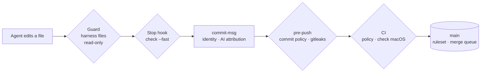

# Quality harness for AI agents

How QOOB3D keeps the quality up while AI agents write most of the code, without slowing the
work down. Decision: ADR-0037.

## Principles

1. **Deterministic wherever possible.** A tool checks, not the agent's diligence.
2. **Brake locally, block in CI.** Locally an agent has the human's permissions; local hooks
   only save a round trip. The wall is CI and the GitHub rules.
3. **Sufficiently safe, not over-regulated.** A check exists because something actually went
   wrong or because it is cheap. A merely conceivable bypass of a local brake is no reason for
   a new gate.
4. **The harness belongs to the human.** Agents propose changes to it; the edit tools refuse
   harness files unless Claude Code was started with `QOOB3D_HARNESS_UNLOCK=1`.
5. **Independent opinions are tools, not gates.** Separate roles for tests and code, the critic
   and the verifier are skills to use when they pay off.

## Layers



## Rules and their checks

| Rule | Local | CI |
| --- | --- | --- |
| Done means `cargo xtask check` is green: fmt, clippy with the strict workspace lints, tests, reference models, smoke test | Stop hook (`check --fast`) | `check (macOS)` |
| No `unsafe`, no `unwrap` in production code, no `dbg!`/`todo!`, no `#[allow]`; `#[expect]` and `#[ignore]` only with a reason | clippy (lints in `Cargo.toml`) | `check (macOS)` |
| The number of lint suppressions never grows (`harness/ratchet.txt`) | `xtask hygiene` | `policy`, `check (macOS)` |
| Unit tests live in `<module>/tests.rs`, never inline | `xtask hygiene` | `policy`, `check (macOS)` |
| Every crate inherits the workspace lints | `xtask hygiene` | `policy`, `check (macOS)` |
| Crate boundaries (ADR-0036) | `xtask arch` | `policy`, `check (macOS)` |
| ADRs are well-formed, the index is current, nothing refers to an unknown or superseded ADR | `xtask docs` | `policy`, `check (macOS)` |
| The repository is English (ADR-0001) | `xtask hygiene` | `policy`, `check (macOS)` |
| No hard-coded UI texts, translations complete (ADR-0020) | `xtask i18n` | `policy`, `check (macOS)` |
| Author and committer are the identity in `harness/identity.txt`; no commit names an AI as author, co-author or generator | commit-msg, pre-push (`xtask commits`) | `policy` |
| No secrets in the history | pre-push (gitleaks) | `policy` |
| Vetted supply chain and licences, no unused dependencies | `xtask check` (cargo-deny) | `policy` (cargo-deny, cargo-machete) |
| The harness changes only with the human's approval | guard (edit tools), `xtask hygiene` (CODEOWNERS covers every harness path) | CODEOWNERS review, `policy` flags harness changes |
| The harness still rejects what it should (`harness/sabotage/`) | `cargo xtask selftest` | `selftest`: weekly and on pull requests that change the harness |
| Tests really check something | – | `mutants`: weekly report, never a gate |

Everything that needs judgment (design, duplication, abstraction, error handling,
accessibility, usability) is a matter for the review of the pull request. The checklist in
`harness/critic-checklist.md` and the style register `docs/design/code-style.md` say what to
look for.

The git hooks share their setup in `.githooks/lib.sh`: they build xtask, on macOS remove the
quarantine attribute that GUI clients such as Sourcetree set, so that Gatekeeper starts it, and
run the binary directly (`cargo xtask` would re-link and re-quarantine it). Commits and pushes
therefore work from Sourcetree.

## Voluntary tools (Claude Code subagents and skills)

| Tool | Purpose |
| --- | --- |
| `/deliver` with `test-author` and `implementer` | tests from the specification in a different context than the code: an independent oracle for geometry, file formats and bugfixes |
| `/critic-review` with `critic` and `verifier` | a second opinion on a diff with a fresh context; severe findings are verified before they are reported |
| `/usability-review` | walkthrough of a UI workflow |
| `/harness-audit` with `harness-auditor` | is the harness still fit for purpose? |

None of them is enforced. The result of a critic review belongs in the pull request
description.

## For humans

```sh
cargo xtask setup                 # once: activate Git hooks
QOOB3D_HARNESS_UNLOCK=1 claude    # session in which agents may change the harness
cargo xtask selftest              # check the harness against all sabotage cases
```

**Once on GitHub:**

1. Ruleset for `main`: pull request required, required checks `policy` and `check (macOS)`,
   no force push, no deletion. The merge queue runs the same checks (`merge_group` trigger).
   Allow only merge commits: squash and rebase merges on GitHub get the committer `GitHub` and
   fail the identity rule.
2. "Require review from Code Owners" (`.github/CODEOWNERS` names the owner of every harness
   path; `cargo xtask hygiene` keeps it complete).
3. Recommended: a separate GitHub identity for the agent (bot account or app) with
   write access to branches, without merge and admin rights.

## Limits

- The guard is a write protection for the edit tools, not a sandbox: a shell command can
  still change a harness file. Such a change shows up in the diff, CI flags it and the code
  owner has to approve it.
- Local hooks can be skipped (`--no-verify`). CI runs the same checks again.
- Usability and accessibility are checked by review only. Deterministic checks (AccessKit
  names of all controls, contrast of the theme colors, target sizes) are still missing.
