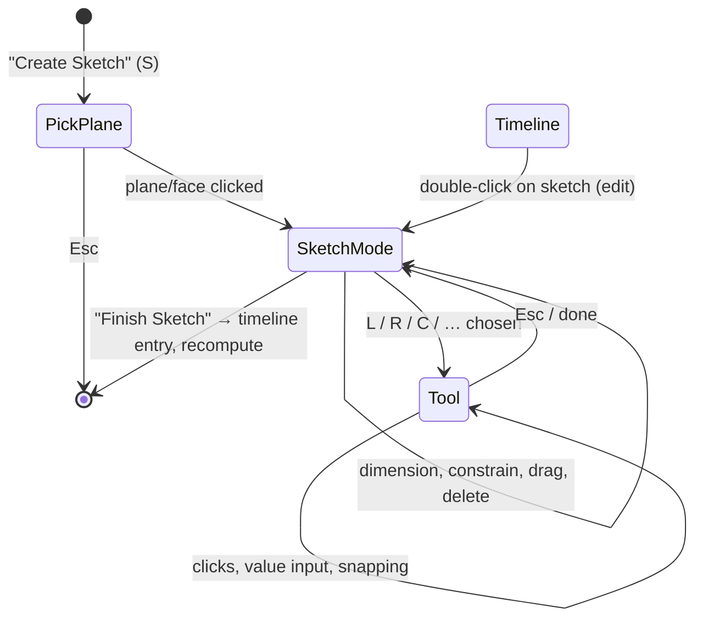
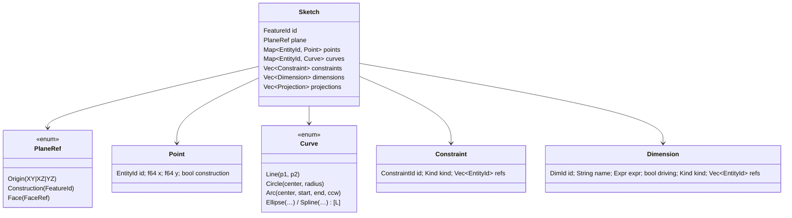

# Requirements: Sketches

As of: 2026-10-13 · Status: **agreed** (all recommendations from section 17 accepted, ADR-0024 to ADR-0029) · Applies from M3

This document describes completely what sketching in QOOB3D must be able to do: planes
(including inclined ones), tools, input, snapping, constraints, dimensions, profiles, data
model, kernel integration, display and tests. It is the basis for milestones M3 onwards.
Decisions that follow from it are recorded as ADRs (section 17 lists the open ones).

**Conventions**

- IDs `SK-<area>-<no>` are stable. Code, tests and ADRs refer to them.
- Obligation: **MUST** (cannot do without), **SHOULD** (belongs to it, justified exception
  possible), **MAY** (convenience).
- Phase: **A** = M3a, **B** = M3b, **C** = M3c, **L** = later (see section 16).
- The model is Autodesk Fusion. Deviations are justified. The FDM focus (ADR-0002) counts
  when weighing options.

---

## 1. Terms

| Term | Meaning |
| --- | --- |
| **Sketch** | Feature in the timeline: 2D geometry on exactly one sketch plane |
| **Sketch plane** | Plane in space with a local coordinate system (origin, u axis, v axis, normal n) |
| **Construction plane** | separate timeline feature that creates a plane (offset, angle, 3 points …) |
| **Entity** | Point or curve (line, circle, arc, …) of a sketch, with a stable ID |
| **Construction geometry** | Entity that only serves as an aid: forms no profiles, drawn dashed |
| **Projected geometry** | edges/points of other objects taken into the sketch, associatively linked |
| **Constraint** | geometric relationship: parallel, tangent, coincident … |
| **Dimension** | dimensional constraint with a value/expression: length, distance, angle, radius … |
| **Degree of freedom (DOF)** | remaining possibility of movement; 0 = fully constrained |
| **Profile / region** | closed area bounded by curves, possibly with islands; input for extrusion |
| **Solver** | solves the equations of all constraints and computes the geometry |

---

## 2. Life cycle of a sketch



| ID | Requirement | Prio | Phase |
| --- | --- | --- | --- |
| SK-LC-01 | "Create Sketch" (toolbar, key **S**) starts plane selection. Origin planes, construction planes and planar body faces can be selected. Origin planes are shown in the viewport meanwhile. | MUST | A (faces: C) |
| SK-LC-02 | If a plane/planar face is already selected before the command, the sketch starts directly on it. | SHOULD | A |
| SK-LC-03 | On entering sketch mode, the camera turns with an animation to the normal view of the plane ("Look At", can be switched off). | SHOULD | A |
| SK-LC-04 | Sketch mode is clearly recognizable: sketch palette, status hint, "Finish Sketch" button, dimmed remaining geometry. | MUST | A |
| SK-LC-05 | "Finish Sketch" (button, Enter without an active tool) ends the mode. The sketch is **one** timeline entry, the rebuild runs from there (ADR-0012). | MUST | A |
| SK-LC-06 | An existing sketch can be edited by double-clicking it in the timeline/browser. The timeline is rolled back to this sketch, later features are hidden meanwhile. | MUST | A |
| SK-LC-07 | If a sketch changes, dependent features are recomputed. If a profile can no longer be matched, the feature is marked red and nothing is guessed (ADR-0011). | MUST | A |
| SK-LC-08 | A sketch session is one undo unit in the timeline. Within the session there is fine-grained undo/redo per tool action (Cmd/Ctrl+Z, Shift+Cmd/Ctrl+Z). | MUST | A |
| SK-LC-09 | Empty sketches may be saved (Fusion behavior), but are marked as "empty" in the timeline. | MAY | A |

---

## 3. Sketch planes

### 3.1 Local coordinate system

Every sketch lives in a right-handed local system **(O, u, v, n)** with
`n = u × v`. Sketch coordinates are 2D `(x, y)` in mm in this system. If the plane moves
(e.g. an offset changes), the sketch moves with it.

```text
              v (local y)
              ▲
              │      sketch lies in the plane,
              │      view against n (n points towards the viewer)
              │
              O────────► u (local x)
             ╱
            ╱
           n (normal, towards the viewer)
```

**Origin planes**: axes identical to the ViewCube faces, so that sketches never appear
mirrored in the corresponding standard view (ADR-0006).

| Plane | View | u | v | n |
| --- | --- | --- | --- | --- |
| XY (print bed) | TOP | +X | +Y | +Z |
| XZ | FRONT | +X | +Z | −Y |
| YZ | RIGHT | +Y | +Z | +X |

| ID | Requirement | Prio | Phase |
| --- | --- | --- | --- |
| SK-PL-01 | Sketches on the three origin planes with the axes from the table above. | MUST | A |
| SK-PL-02 | The local system of every plane type is defined **deterministically** (same inputs → same axes). Otherwise sketches jump during rebuild or get mirrored. The rule below applies to every plane type. | MUST | A/C |
| SK-PL-03 | The back of a plane can be sketched on ("Look At" from behind). The local orientation stays unchanged, only the camera looks from −n. | SHOULD | A |
| SK-PL-04 | On hover, plane selection shows a preview of the plane with its u/v axes. | SHOULD | A |

### 3.2 Construction planes (including inclined)

Construction planes are **separate timeline features** with editable parameters. They
are associative: if the reference changes, the plane changes and with it every sketch on it.

| ID | Plane type | Inputs | Rule for (O, u, v, n) | Prio | Phase |
| --- | --- | --- | --- | --- | --- |
| SK-PL-10 | **Offset plane** | reference plane/planar face, distance (expression, ±) | O' = O + d·n, axes as reference | MUST | C |
| SK-PL-11 | **Plane at angle** (inclined) | rotation axis (origin axis, sketch line, straight edge), reference plane containing the axis, angle | u = axis direction, n = reference normal rotated about u, v = n × u, O = projection of the reference origin onto the axis | MUST | C |
| SK-PL-12 | **Plane through three points** | 3 points (corners, sketch points) | O = P1, u = normalized(P2 − P1), n = normalized(u × (P3 − P1)), v = n × u | SHOULD | C |
| SK-PL-13 | **Midplane** | two parallel planar faces/planes | O in the middle, axes as first reference | SHOULD | C |
| SK-PL-14 | **Plane through two edges** | two coplanar straight edges | O = start point of edge 1, u = edge 1, n = u × edge 2 | MAY | L |
| SK-PL-15 | **Tangent plane** | cylindrical/conical face, reference plane, angle | at the contact line, u along the axis | MAY | L |
| SK-PL-16 | **Plane along path** | curve, position (0–1 or distance) | n = tangent, u from principal normal | MAY | L |

In case of ambiguity (e.g. an edge that lies in several planes) the tool asks instead of
choosing silently.

### 3.3 Sketches on body faces

| ID | Requirement | Prio | Phase |
| --- | --- | --- | --- |
| SK-PL-20 | Every **planar** body face can be selected as a sketch plane. | MUST | C |
| SK-PL-21 | Axes on faces: n = outer face normal; u = projection of world X onto the plane if not degenerate, otherwise of world Y; v = n × u; O = projection of the world origin onto the plane. | MUST | C |
| SK-PL-22 | The face reference must survive rebuilds (topological naming). The strategy is decided by ADR **before** C (see E-04). If a face can no longer be matched: sketch red, offer "choose new plane", the geometry is kept. | MUST | C |
| SK-PL-23 | When sketching on a face, its edges are **not** projected automatically (Fusion option "Auto project edges" as a setting). | SHOULD | C |

---

## 4. View and interaction in sketch mode

| ID | Requirement | Prio | Phase |
| --- | --- | --- | --- |
| SK-UI-01 | The cursor is mapped onto the sketch plane by raycast. This works for any position of the plane, including inclined and from an oblique viewing angle. If the plane is almost perpendicular to the view (< 5°), there is no input, only a hint. | MUST | A |
| SK-UI-02 | A sketch grid lies in the sketch plane (local axes, spacing coupled to zoom like the world grid, ADR-0021). The world grid is dimmed. | MUST | A |
| SK-UI-03 | Navigation stays as before (ADR-0008). **In sketch mode, left-drag is used for drawing, dragging and selecting** and not for orbit (see E-06). | MUST | A |
| SK-UI-04 | The sketch palette (right, collapsible) contains: construction on/off (X), Look At, grid on/off, snapping on/off, show profiles, show points, show dimensions, show constraints, slice on/off, Finish Sketch. | MUST | A (constraints: B) |
| SK-UI-05 | **Slice:** bodies are displayed cut open at the sketch plane so that one can draw inside them. | SHOULD | C |
| SK-UI-06 | Other bodies can be set to semi-transparent in sketch mode. | MAY | L |
| SK-UI-07 | Keys: **Esc** cancels the current step, the second time the tool is ended. **Enter** confirms. **Tab** switches the input field. **Delete/Backspace** deletes the selection. Tool shortcuts see section 5. | MUST | A |
| SK-UI-08 | Selection: click selects, Shift/Cmd extends. Window **left→right** selects only what is completely inside; **right→left** also what is crossed (Fusion semantics). | MUST | A |
| SK-UI-09 | Hover highlights entities, points and profiles (mint). The pick tolerance is given in screen pixels (default 6 px), points take precedence over curves, curves over profiles. | MUST | A |
| SK-UI-10 | Dragging points/curves moves them live. With the solver (B) all constraints are kept (minimal movement of the remaining geometry). | MUST | A (B) |
| SK-UI-11 | Context menu (right-click): repeat tool, toggle construction, constraints of the selection, delete, Finish Sketch. | SHOULD | B |
| SK-UI-12 | All texts, tooltips and input hints are translated (ADR-0020). | MUST | A |

---

## 5. Drawing tools

Every tool is a **state machine without egui** (inputs: points in sketch coordinates,
values, keys → output: commands to the sketch model). This makes it testable headless
(SK-QA-01). "Automatic constraints" arise from snapping (section 7) and are stored with the
solver (B); before that (A) they are only used to align the coordinates.

### 5.1 Create

| ID | Tool | Key | Flow | creates | Prio | Phase |
| --- | --- | --- | --- | --- | --- | --- |
| SK-TL-01 | **Line / polyline** | L | Click start → click end → continue as a chain until Esc/double-click/closing at the start point. Length and angle can be typed. | points, lines, coincidence at the nodes | MUST | A |
| SK-TL-02 | Tangent arc from the line | (in L) | *Dragging* from the last end point instead of clicking creates a tangent arc (Fusion). | arc + tangent | SHOULD | B |
| SK-TL-03 | **Rectangle, 2 points** | R | corner → opposite corner. Width/height can be typed. | 4 lines, 4 points, H/V constraints | MUST | A |
| SK-TL-04 | Rectangle, center | – | center → corner | as above + symmetry to center point (construction) | SHOULD | A |
| SK-TL-05 | Rectangle, 3 points (rotated) | – | edge (2 points) → depth | 4 lines, parallel/perpendicular | SHOULD | B |
| SK-TL-06 | **Circle, center–diameter** | C | center → diameter (can be typed) | circle + center point | MUST | A |
| SK-TL-07 | Circle, 2 points / 3 points | – | points on the circumference | circle | SHOULD | B |
| SK-TL-08 | Circle, 2/3 tangent | – | tangent to selected curves | circle + tangent constraints | MAY | L |
| SK-TL-09 | **Arc**: 3 points, center, tangent | A | click sequence | arc + points | MUST | B |
| SK-TL-10 | **Slot**: center–center, overall, center point, arc slot | – | 2 points → width | 2 lines + 2 arcs + constraints | SHOULD | B |
| SK-TL-11 | **Polygon**: circumscribed, inscribed, by edge | – | center → corner, number of corners can be typed | n lines + equal + construction circle | SHOULD | B |
| SK-TL-12 | **Point** | – | click | point (e.g. for holes) | MUST | A |
| SK-TL-13 | **Ellipse** | – | center → major axis → minor axis | ellipse | MAY | L |
| SK-TL-14 | **Spline** (fit points / control points) | – | click sequence, Enter ends | spline | MAY | L |
| SK-TL-15 | **Text** (font, height, alignment, on path) – for FDM: embossing/engraving | T* | window → text | text object → profiles | SHOULD | L |
| SK-TL-16 | **Toggle construction** | X | selection → construction on/off; also as a mode while drawing | – | MUST | A |
| SK-TL-17 | **Centerline/axis** as a construction line with axis marking (for rotation, symmetry) | – | like line | construction line | SHOULD | B |

\* Key T is "Trim" in Fusion; text gets no shortcut.

### 5.2 Modify

| ID | Tool | Key | Flow | Prio | Phase |
| --- | --- | --- | --- | --- | --- |
| SK-ED-01 | **Delete** | Del | delete selection, including dependent constraints | MUST | A |
| SK-ED-02 | **Trim** | T | remove curve segment up to the next intersection (hover shows the segment) | MUST | B |
| SK-ED-03 | **Extend** | E | extend curve up to the next curve | SHOULD | B |
| SK-ED-04 | **Break** | – | split curve at intersection points | SHOULD | B |
| SK-ED-05 | **Sketch fillet / chamfer** | – | select corner, enter radius or distance | MUST | B |
| SK-ED-06 | **Offset** | O | select chain, distance ±, preview. **FDM: wall thickness, fit clearance** | MUST | B |
| SK-ED-07 | **Mirror** | – | objects + mirror line → mirrored copy + symmetry constraints | SHOULD | B |
| SK-ED-08 | **Pattern** rectangular / circular | – | count, spacing/angle, associative | SHOULD | L |
| SK-ED-09 | **Move/copy, rotate, scale** | M | selection → base point → target/values | SHOULD | B |
| SK-ED-10 | **Project** | P | take edges/points of bodies or other sketches into the sketch, associative (updates itself) | MUST | C |
| SK-ED-11 | **Intersection curve** (Intersect) | – | intersection of body and sketch plane as a curve | SHOULD | C |

---

## 6. Value input while drawing

| ID | Requirement | Prio | Phase |
| --- | --- | --- | --- |
| SK-IN-01 | Input fields right at the cursor (Fusion: "heads-up"): e.g. length and angle for the line, width and height for the rectangle, diameter for the circle. Typing writes immediately into the active field. | MUST | A |
| SK-IN-02 | **Tab** switches the field. A confirmed value **locks** the dimension (lock symbol), the cursor then only determines the remaining degrees of freedom. Enter applies. | MUST | A |
| SK-IN-03 | Expressions: `20`, `20 mm`, `1 in`, `25.4/2`, `(30 - 2*1.2)`, later `parameter_name * 2`. Invalid input → field red plus reason, nothing is applied. | MUST | A (parameters: B) |
| SK-IN-04 | Decimal separator: a point is always allowed, additionally that of the UI language (comma for German). | MUST | A |
| SK-IN-05 | With the solver (B) typed values create **driving dimensions**, without the solver (A) they only set the geometry. | MUST | A/B |
| SK-IN-06 | Angles in degrees, positive counterclockwise from local +u. | MUST | A |
| SK-IN-07 | The display unit is configurable (mm default, inches later). Storage is always in mm (ADR-0006). | SHOULD | L |

---

## 7. Snapping and alignment (inference)

| ID | Requirement | Prio | Phase |
| --- | --- | --- | --- |
| SK-SN-01 | Snap targets: end point, midpoint, circle/arc center, quadrant point, intersection, nearest point on curve, sketch origin, local axes, grid points. | MUST | A |
| SK-SN-02 | Alignment lines (dashed): horizontal/vertical to known points, extension of lines, parallel/perpendicular to the reference line, tangent. | MUST | A (tangent: B) |
| SK-SN-03 | The snap tolerance is given in screen pixels (default 8 px), independent of zoom. Priority: point targets > intersection > alignment > curve > grid. | MUST | A |
| SK-SN-04 | Feedback: symbol at the cursor (e.g. ⌐ end point, △ midpoint, ⊥ perpendicular), tooltip with the name, highlighting of the reference. | MUST | A |
| SK-SN-05 | Holding **Cmd/Ctrl** temporarily suppresses snapping. Snapping and grid can be switched off in the palette. | MUST | A |
| SK-SN-06 | Snapped relationships are stored (with the solver) as constraints: coincidence, horizontal/vertical, parallel, perpendicular, tangent, point on curve. | MUST | B |
| SK-SN-07 | Snapping also works on projected geometry and on body edges that lie in the plane. | SHOULD | C |

---

## 8. Constraints

### 8.1 Geometric constraints (phase B)

| ID | Constraint | Applies to | removes DOF |
| --- | --- | --- | --- |
| SK-CN-01 | Coincident | point–point, point–curve | 2 or 1 |
| SK-CN-02 | Horizontal / vertical | line, two points | 1 |
| SK-CN-03 | Parallel / perpendicular | two lines | 1 |
| SK-CN-04 | Collinear | two lines | 2 |
| SK-CN-05 | Tangent | line–arc/circle, arc–arc | 1 |
| SK-CN-06 | Smooth (G2) | spline–curve | 1–2 (L) |
| SK-CN-07 | Concentric | circles/arcs | 2 |
| SK-CN-08 | Midpoint | point – line | 2 |
| SK-CN-09 | Equal | lines (length), circles/arcs (radius) | 1 |
| SK-CN-10 | Symmetric | two points/curves about a line | 2 |
| SK-CN-11 | Fixed | point/curve | all |

### 8.2 Dimensions (phase B)

| ID | Dimension |
| --- | --- |
| SK-DM-01 | Length of a line; distance point–point (aligned, horizontal, vertical) |
| SK-DM-02 | Distance point–line, line–line (parallel) |
| SK-DM-03 | Angle between two lines (quadrant selectable by mouse position) |
| SK-DM-04 | Diameter / radius (default: circle → diameter, arc → radius) |
| SK-DM-05 | Arc length (L) |

### 8.3 Behavior

| ID | Requirement | Prio | Phase |
| --- | --- | --- | --- |
| SK-CN-20 | Tool **Dimension** (D): click one or two elements → the type follows from the selection → placement by mouse → type value/expression. | MUST | B |
| SK-CN-21 | Double-clicking a dimension edits it. Every dimension gets a name (`d1, d2 …`) that can be used in expressions and can be renamed. | MUST | B |
| SK-CN-22 | **Driven (reference) dimensions** only display and do not drive. They are created automatically when a driving dimension would over-constrain (with confirmation). | MUST | B |
| SK-CN-23 | Status visible per entity: under-constrained, fully constrained, over-constrained/conflict (colors in section 11). The number of remaining degrees of freedom is shown in the status bar. | MUST | B |
| SK-CN-24 | **Conflicts are never resolved silently:** a contradictory constraint is rejected or marked as a conflict, and the constraints involved are highlighted. | MUST | B |
| SK-CN-25 | Constraints appear as symbols on the geometry (can be shown/hidden). Hover highlights the participants, selection + Del deletes them. | MUST | B |
| SK-CN-26 | Dragging under-constrained geometry: the solver moves as little as possible and keeps all constraints. | MUST | B |
| SK-CN-27 | User parameters (table, e.g. `clearance = 0.2 mm`, `wall = 1.2 mm`) can be used in all expressions. **FDM: change tolerances centrally.** | SHOULD | B |

### 8.4 Solver requirements (phase B)

| ID | Requirement |
| --- | --- |
| SK-SV-01 | Interactive: solution while dragging < 16 ms for sketches up to 200 entities / 400 constraints (measured in the release build). |
| SK-SV-02 | Deterministic: same input → same solution (start values = stored geometry). This is a prerequisite for reproducible rebuilds. |
| SK-SV-03 | Degrees of freedom can be determined per entity and in total. Redundant and contradictory constraints are detected and named. |
| SK-SV-04 | Runs in the UI thread (interactivity) or in a separate thread with the result in the same frame. **Never** in the kernel thread (OCCT-free, ADR-0005). |
| SK-SV-05 | Implementation by ADR (E-01): existing library or own solver. Criteria are license, Rust binding, robustness and conflict diagnosis. |

---

## 9. Profiles (regions)

| ID | Requirement | Prio | Phase |
| --- | --- | --- | --- |
| SK-PR-01 | Every area enclosed by curves is a profile, also with overlaps (circle over rectangle → 3 regions) and nesting (ring = outer contour minus island). | MUST | A |
| SK-PR-02 | Construction geometry forms no profiles. Projected geometry forms profiles unless it is marked as construction. | MUST | A (proj.: C) |
| SK-PR-03 | Profiles are lightly tinted in sketch mode and when selecting for features. Hover highlights the individual profile. | MUST | A |
| SK-PR-04 | Tolerance for "closed": end points within 1e-6 mm count as connected (with the solver exact through coincidence). Open contours are marked (end points red) so that gaps are visible. | MUST | A |
| SK-PR-05 | Profile computation in the kernel (OCCT: curves → edges → General Fuse → faces), result as 2D polygons and stable keys back to the UI (ADR-0011). | MUST | A |
| SK-PR-06 | Profile identity across changes: key from the bounding entity IDs (ADR-0011). With the solver, IDs stay stable on dimension changes, trimming creates new IDs (matching via the origin of the sub-curves, see E-05). | MUST | A/B |
| SK-PR-07 | Open contours can be used for later features (path for sweep, thin extrusion). | MAY | L |

---

## 10. Data model (proposal)



| ID | Requirement | Prio | Phase |
| --- | --- | --- | --- |
| SK-DT-01 | **Points are separate entities**, curves reference point IDs (line = 2 points, circle = center + radius). This makes coincidence a real relationship instead of equality of coordinates. Decided in **ADR-0024** (replaces the earlier primitives decision), see E-02. | MUST | A |
| SK-DT-02 | The rectangle is not a separate type but 4 lines + constraints. The tool only remembers the group for joint selection. | MUST | A |
| SK-DT-03 | All IDs are stable, unique and never reused (counter per sketch). | MUST | A |
| SK-DT-04 | Values the user enters are stored as an **expression** (`Expr`, text + evaluated cache), not just as a number. | MUST | A |
| SK-DT-05 | Sketch coordinates in `f64` mm in the local system. Without the solver (A) they are the truth, with the solver (B) the start value. | MUST | A |
| SK-DT-06 | Serialization in the project format (ADR-0030) with migrations. Fixture files per format version. | MUST | A |
| SK-DT-07 | Projections store the source (feature + element reference) and are updated on rebuild. | MUST | C |

---

## 11. Display

| ID | Element | Display | Phase |
| --- | --- | --- | --- |
| SK-VS-01 | Curves, under-constrained | mint (accent), 1.6 pt | A |
| SK-VS-02 | Curves, fully constrained | light gray/white, 1.6 pt | B |
| SK-VS-03 | Conflict/over-constrained | red | B |
| SK-VS-04 | Construction geometry | dashed, muted amber | A |
| SK-VS-05 | Points | small squares (end points), center points as a cross | A |
| SK-VS-06 | Profiles | mint at ~12 % opacity, hover ~25 % | A |
| SK-VS-07 | Dimensions | dimension lines and text in the plane, text always rotated to be readable for the viewer | B |
| SK-VS-08 | Constraint symbols | small glyphs next to the geometry, not overlapping | B |
| SK-VS-09 | Preview while drawing | dashed, mint | A |
| SK-VS-10 | Inactive sketches (outside the mode) | thin, gray, profiles invisible; visibility per sketch switchable in the browser | A |

Sketches are drawn as an egui overlay over the viewport (curves, dashes, profile areas as a
mesh, snap symbols, HUD), not in the wgpu line pipeline (ADR-0027). The grid lies in the
sketch plane (wgpu, `GridPlane`). Dimension text is created like the ViewCube labels as a
text mesh in the plane (ADR-0015).

---

## 12. Kernel integration

| ID | Requirement | Prio | Phase |
| --- | --- | --- | --- |
| SK-KN-01 | Sketch plane → `gp_Ax3` (O, n, u). Curves → OCCT edges in 3D, own C++ wrappers, exception-safe (ADR-0014). | MUST | A |
| SK-KN-02 | Profile building: all non-construction curves → `BOPAlgo_Builder`/General Fuse in the plane → faces. Per face: outer and inner wires, bounding entity IDs → profile key. | MUST | A |
| SK-KN-03 | The kernel delivers profiles as 2D polygons (for display/hover) and as B-Rep (internal, for features). | MUST | A |
| SK-KN-04 | The kernel computes the planes of construction planes and faces (features), the UI receives `(O, u, v, n)` as plain data. | MUST | C |
| SK-KN-05 | Profile computation runs asynchronously (ADR-0005). Until the result is available, the UI shows the curves without profile fill, drawing is never blocked. | MUST | A |

---

## 13. FDM-specific requirements

| ID | Requirement | Prio | Phase |
| --- | --- | --- | --- |
| SK-FD-01 | The default sketch plane is **XY (print bed)**. Plane selection suggests it first. | SHOULD | A |
| SK-FD-02 | **Slot** and **offset** are available early (B): typical means for screw holes and fits. | MUST | B |
| SK-FD-03 | User parameters for **clearance/tolerance** and **wall thickness**, preset (`clearance = 0.2 mm`, `wall = 1.2 mm`), usable in expressions. | SHOULD | B |
| SK-FD-04 | Warning for details below the nozzle width (e.g. walls/gaps < 0.4 mm in the profile), can be switched off, nozzle width configurable. | MAY | L |
| SK-FD-05 | **Text** with font choice for labels to emboss/engrave. Hint when the stroke width is too small. | SHOULD | L |
| SK-FD-06 | If the sketch lies on XY, it keeps showing print bed, exclusion zones and single-nozzle zones (ADR-0021), so that one draws within the printable area. | SHOULD | A |

---

## 14. Performance and robustness

| ID | Requirement |
| --- | --- |
| SK-PF-01 | Drawing, snapping, hover: < 4 ms CPU per frame with 500 entities (release), so that 60–120 Hz stays smooth. |
| SK-PF-02 | Profile computation in the kernel thread: < 100 ms for 500 entities. Outdated results are discarded (ADR-0005). |
| SK-PF-03 | No input may cause a crash (lengths 0, identical points, NaN, huge values). Invalid input is rejected or marked. |
| SK-PF-04 | Numerics: lengths internally `f64`, coincidence tolerance 1e-6 mm, output to OCCT with its precision (1e-7). |

---

## 15. Quality assurance and tests

| ID | Requirement |
| --- | --- |
| SK-QA-01 | Tool state machines, snapping and solver are testable **without egui and without OCCT** (separate module or crate, see E-07). Every tool has tests for flow, cancel (Esc) and value input. |
| SK-QA-02 | Property tests: random sketches → solver solution satisfies all constraints (residuals < 1e-9); serialize → load yields identity. |
| SK-QA-03 | Golden tests for profiles: fixture sketches (rectangle with circle, intersecting shapes, islands, open contour) → expected number and area of the regions. |
| SK-QA-04 | UI tests (egui_kittest, ADR-0018): draw a rectangle by clicks + value input, finish the sketch, check the timeline entry; screenshot in sketch mode. |
| SK-QA-05 | Smoke test: create a sketch on XY, draw a rectangle, finish (synthetic input). |
| SK-QA-06 | Inclined plane: test that raycast → sketch coordinate → 3D leads back exactly for a 30° plane (round trip < 1e-9). |

---

## 16. Phase proposal

The original MVP excluded the constraint solver. Clean sketching without constraints quickly
feels makeshift, though: a rectangle can no longer be changed sensibly afterwards, and a
coincidence is only equality of coordinates. Proposal: the data model is solver-capable
**from the start** (points as entities, SK-DT-01), the solver follows directly in M3b.

| Phase | Content | Result for you |
| --- | --- | --- |
| **M3a** | Document model + save/load, sketch mode on XY/XZ/YZ, line/polyline, rectangle (2 points, center), circle, point, construction, value input at the cursor, snapping + alignment lines, select/drag/delete, profiles with islands, undo/redo, timeline/browser entry | First real sketches, saved, extrudable from M4 |
| **M3b** | Solver, constraints + symbols, dimension (D), DOF colors, conflict display, user parameters, arc, slot, polygon, trim/extend/break, fillet/chamfer, offset, mirror, move/rotate | Parametric sketching as in Fusion |
| **M3c** | Construction planes (offset, **angle/inclined**, 3 points, midplane), sketches on planar faces, project, intersection curve, slice | Sketches everywhere, including inclined and on bodies |
| **later** | Ellipse, spline, text, pattern, tangent circles, further plane types, nozzle width warning, inches | – |

This moves extrusion (previously M4) behind M3a. Proposal: **M4 (extrusion) directly after
M3a**, so that real parts appear early, and M3b/M3c afterwards. That way a printable part is
already possible after M3a + M4.

---

## 17. Open decisions

| ID | Question | Recommendation |
| --- | --- | --- |
| E-01 | Which solver? | Short comparison (spike) before M3b. Candidates: (a) **own solver in Rust** (Newton/Levenberg-Marquardt + DOF analysis via Jacobian rank); (b) **planegcs** from FreeCAD (C++, LGPL-2.1, mature, needs Eigen/Boost); (c) SolveSpace solver (**GPL-3** → only possible with a GPL license). Recommendation: compare (a) against (b) in the spike, result as an ADR. |
| E-02 | Points as entities instead of primitives? → **decided: ADR-0024** | **Yes**, already in M3a. A later migration would be more expensive than now. |
| E-03 | Bring the solver forward (lift the MVP exclusion)? | **Yes**, as M3b directly after M3a/M4. |
| E-04 | Topological naming for sketches on faces | Separate ADR before M3c. Candidate: faces via the generating feature + origin (e.g. "top face of Extrude 3, profile X") instead of an index. |
| E-05 | Profile identity after trim/break | New curves carry the origin ID of the original curve; profile key = set of origin IDs plus side. Details in the M3b ADR. |
| E-06 | Left-drag in sketch mode (conflict with ADR-0022) | In sketch mode the left mouse button **draws/drags/selects**. Orbit then via Shift + two fingers / Shift + middle mouse button. Outside the mode ADR-0022 remains. |
| E-07 | Where do sketch logic and solver live? | **New crate `qoob3d-sketch`** (pure, without OCCT/GPU/UI; depends only on core). Tool state machines + snapping + solver there, the UI only translates inputs. New crate edge → ADR. |
| E-08 | "Look At" on sketch start on by default? | Yes (like Fusion), can be switched off. |
| E-09 | Automatic constraints from snapping on by default? | Yes (like Fusion). Temporarily off with Cmd/Ctrl. |
| E-10 | Order M3a → M4 → M3b → M3c? | Yes, see section 16. |

## 18. Implementation status

Status after M3a (2026-10-13). All phase A requirements are implemented, except:

| ID | Status | When |
| --- | --- | --- |
| SK-LC-06 | Editing by double-click works. Rolling back the timeline is not needed as long as there are no features after sketches | M4 |
| SK-LC-09 | Empty sketches are saved, but not marked as "empty" in the timeline | open (MAY) |
| SK-PL-03 | Look At always from +n, back side not yet selectable | M3c |
| SK-PL-04 | Plane hover highlights the plane, u/v axes are missing | open |
| SK-UI-02 | Grid lies in the sketch plane; the world grid is not additionally dimmed because it is replaced | met in spirit |
| SK-UI-08 | Shift extends the selection, Cmd not yet | open |
| SK-SN-04 | Snap symbols and alignment lines yes, tooltip with the name is missing | open |
| SK-DT-02 | Rectangle = 4 lines; joint group selection is missing | M3b (with H/V constraints) |
| SK-DT-04 | Inputs are evaluated as expressions (`core::expr`), only the geometry is stored. Expressions are stored by dimensions | M3b |
| SK-KN-03 | Profiles as 2D polygons yes; B-Rep for features | M4 |

Brought forward from phase B (for the sphere, M4): arc around center (SK-TL-09 partial,
tool A). 3-point and tangent arcs follow with M3b.

Tests: tools, snapping, selection, editing in `qoob3d-sketch`; profiles in
`qoob3d-kernel/src/profiles.rs`; format, validation and fixture in `qoob3d-core`; end-to-end
(pick plane → rectangle with typed dimensions → profile → finish → undo/redo, close polyline)
in `crates/qoob3d-app/tests/ui.rs`; real app in `--smoke-test`.

## References

- ADR-0002 (FDM focus), ADR-0005 (kernel thread), ADR-0006 (coordinates), ADR-0030
  (project format), ADR-0011
  (profile references), ADR-0012 (rebuild), ADR-0014 (OCCT wrappers), ADR-0015 (overlays),
  ADR-0019 (rendering), ADR-0020 (i18n), ADR-0021 (printers), ADR-0022 (left-drag orbit)
- `docs/design/controls.md`, `docs/design/theme.md`
