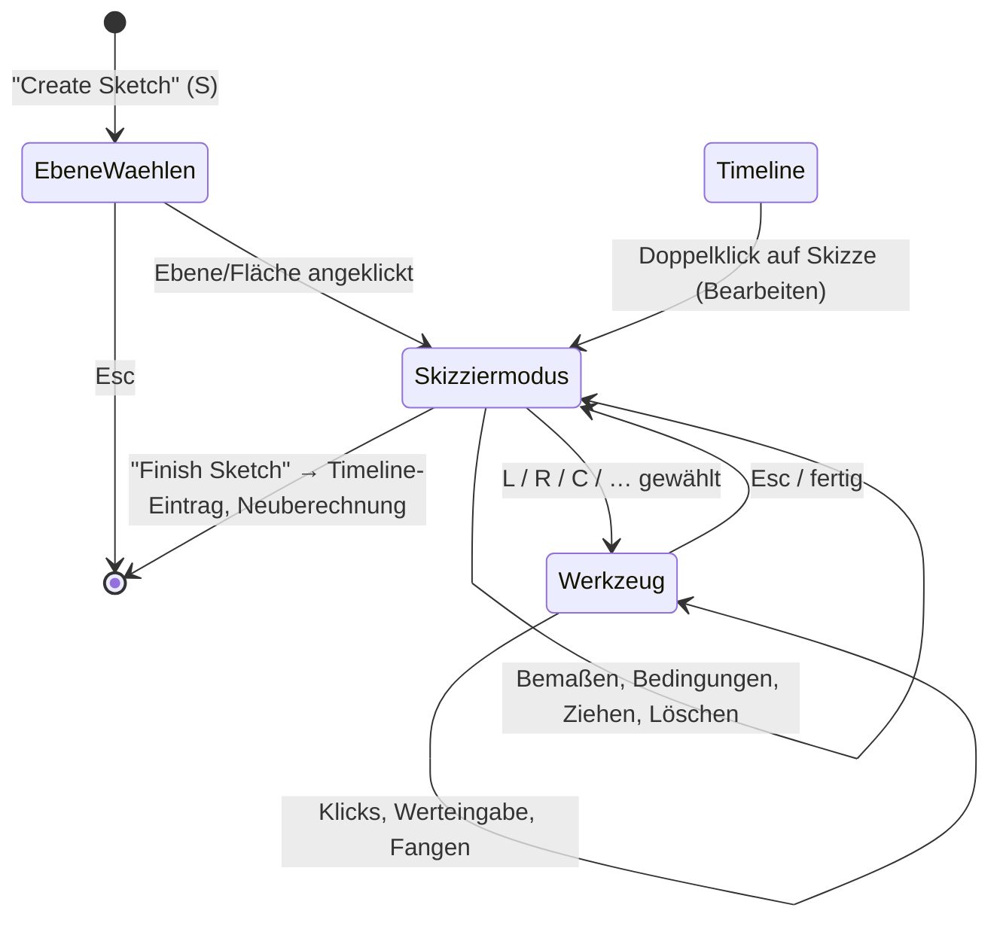
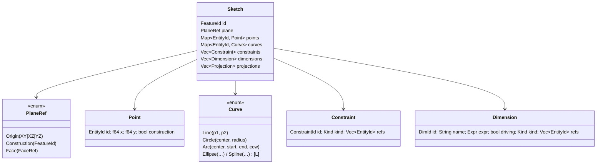

# Anforderungen: Skizzen

Stand: 2026-10-13 · Status: **Entwurf zur Abstimmung** · Gilt ab M3

Dieses Dokument beschreibt vollständig, was Skizzieren in QOOB3D können muss: Ebenen
(auch schräge), Werkzeuge, Eingabe, Fangen, Bedingungen, Bemaßung, Profile, Datenmodell,
Kernel-Anbindung, Darstellung und Tests. Es ist die Grundlage für die Meilensteine M3 ff.
Entscheidungen, die daraus folgen, werden als ADRs festgehalten (Abschnitt 17 listet die
offenen).

**Konventionen**

- IDs `SK-<Bereich>-<Nr>` sind stabil. Code, Tests und ADRs verweisen darauf.
- Verbindlichkeit: **MUSS** (ohne geht es nicht), **SOLL** (gehört dazu, begründete
  Ausnahme möglich), **KANN** (Komfort).
- Phase: **A** = M3a, **B** = M3b, **C** = M3c, **L** = später (siehe Abschnitt 16).
- Vorbild ist Autodesk Fusion. Abweichungen sind begründet. Der FDM-Fokus (ADR-0002) zählt
  bei Abwägungen.

---

## 1. Begriffe

| Begriff | Bedeutung |
| --- | --- |
| **Skizze** | Feature in der Timeline: 2D-Geometrie auf genau einer Skizzenebene |
| **Skizzenebene** | Ebene im Raum mit lokalem Koordinatensystem (Ursprung, u-, v-Achse, Normale n) |
| **Konstruktionsebene** | eigenes Timeline-Feature, das eine Ebene erzeugt (Abstand, Winkel, 3 Punkte …) |
| **Entität** | Punkt oder Kurve (Linie, Kreis, Bogen, …) einer Skizze, mit stabiler ID |
| **Konstruktionsgeometrie** | Entität, die nur als Hilfe dient: bildet keine Profile, gestrichelt dargestellt |
| **Projizierte Geometrie** | in die Skizze übernommene Kanten/Punkte anderer Objekte, assoziativ verknüpft |
| **Bedingung (Constraint)** | geometrische Beziehung: parallel, tangential, koinzident … |
| **Bemaßung** | maßliche Bedingung mit Wert/Ausdruck: Länge, Abstand, Winkel, Radius … |
| **Freiheitsgrad (DOF)** | verbleibende Bewegungsmöglichkeit; 0 = vollständig bestimmt |
| **Profil / Region** | geschlossene Fläche, die von Kurven begrenzt wird, ggf. mit Inseln; Eingabe für Extrusion |
| **Solver** | löst die Gleichungen aller Bedingungen und berechnet die Geometrie |

---

## 2. Lebenszyklus einer Skizze



| ID | Anforderung | Prio | Phase |
| --- | --- | --- | --- |
| SK-LC-01 | „Create Sketch“ (Werkzeugleiste, Taste **S**) startet die Ebenenwahl. Wählbar sind Ursprungsebenen, Konstruktionsebenen und planare Körperflächen. Ursprungsebenen werden dabei im Viewport eingeblendet. | MUSS | A (Flächen: C) |
| SK-LC-02 | Ist vor dem Befehl bereits eine Ebene/planare Fläche ausgewählt, startet die Skizze direkt darauf. | SOLL | A |
| SK-LC-03 | Beim Eintritt in den Skizziermodus dreht die Kamera animiert auf die Normalenansicht der Ebene („Look At“, abschaltbar). | SOLL | A |
| SK-LC-04 | Der Skizziermodus ist klar erkennbar: Skizzenpalette, Statushinweis, „Finish Sketch“-Button, gedimmte übrige Geometrie. | MUSS | A |
| SK-LC-05 | „Finish Sketch“ (Button, Enter ohne aktives Werkzeug) beendet den Modus. Die Skizze ist **ein** Timeline-Eintrag, der Rebuild läuft ab dort (ADR-0012). | MUSS | A |
| SK-LC-06 | Eine bestehende Skizze lässt sich per Doppelklick in Timeline/Browser bearbeiten. Die Timeline wird bis zu dieser Skizze zurückgerollt, spätere Features sind währenddessen ausgeblendet. | MUSS | A |
| SK-LC-07 | Ändert sich eine Skizze, werden abhängige Features neu berechnet. Kann ein Profil nicht mehr zugeordnet werden, wird das Feature rot markiert und nichts geraten (ADR-0011). | MUSS | A |
| SK-LC-08 | Eine Skizzensitzung ist eine Undo-Einheit in der Timeline. Innerhalb der Sitzung gibt es feingranulares Undo/Redo pro Werkzeugaktion (Cmd/Ctrl+Z, Shift+Cmd/Ctrl+Z). | MUSS | A |
| SK-LC-09 | Leere Skizzen dürfen gespeichert werden (Fusion-Verhalten), werden in der Timeline aber als „leer“ gekennzeichnet. | KANN | A |

---

## 3. Skizzenebenen

### 3.1 Lokales Koordinatensystem

Jede Skizze lebt in einem rechtshändigen lokalen System **(O, u, v, n)** mit
`n = u × v`. Skizzenkoordinaten sind 2D `(x, y)` in mm in diesem System. Wandert die Ebene
(z. B. ein Abstand ändert sich), wandert die Skizze mit.

```text
              v (lokal y)
              ▲
              │      Skizze liegt in der Ebene,
              │      Blick entgegen n (n zeigt zum Betrachter)
              │
              O────────► u (lokal x)
             ╱
            ╱
           n (Normale, zum Betrachter)
```

**Ursprungsebenen**: Achsen identisch mit den ViewCube-Flächen, damit Skizzen in der
zugehörigen Standardansicht nie gespiegelt erscheinen (ADR-0006).

| Ebene | Ansicht | u | v | n |
| --- | --- | --- | --- | --- |
| XY (Druckbett) | OBEN | +X | +Y | +Z |
| XZ | VORNE | +X | +Z | −Y |
| YZ | RECHTS | +Y | +Z | +X |

| ID | Anforderung | Prio | Phase |
| --- | --- | --- | --- |
| SK-PL-01 | Skizzen auf den drei Ursprungsebenen mit den Achsen aus der Tabelle oben. | MUSS | A |
| SK-PL-02 | Das lokale System jeder Ebenenart ist **deterministisch** definiert (gleiche Eingaben → gleiche Achsen). Sonst springen Skizzen beim Rebuild oder werden gespiegelt. Für jede Ebenenart gilt die Regel unten. | MUSS | A/C |
| SK-PL-03 | Die Rückseite einer Ebene ist skizzierbar („Look At“ von hinten). Die lokale Orientierung bleibt dabei unverändert, nur die Kamera schaut von −n. | SOLL | A |
| SK-PL-04 | Die Ebenenwahl zeigt beim Überfahren eine Vorschau der Ebene mit ihren u/v-Achsen. | SOLL | A |

### 3.2 Konstruktionsebenen (auch schräg)

Konstruktionsebenen sind **eigene Timeline-Features** mit editierbaren Parametern. Sie
sind assoziativ: Ändert sich die Referenz, ändert sich die Ebene und damit jede Skizze darauf.

| ID | Ebenenart | Eingaben | Regel für (O, u, v, n) | Prio | Phase |
| --- | --- | --- | --- | --- | --- |
| SK-PL-10 | **Versetzte Ebene** | Bezugsebene/planare Fläche, Abstand (Ausdruck, ±) | O' = O + d·n, Achsen wie Bezug | MUSS | C |
| SK-PL-11 | **Ebene unter Winkel** (schräg) | Drehachse (Ursprungsachse, Skizzenlinie, gerade Kante), Bezugsebene, die die Achse enthält, Winkel | u = Achsrichtung, n = Bezugsnormale um u gedreht, v = n × u, O = Projektion des Bezugsursprungs auf die Achse | MUSS | C |
| SK-PL-12 | **Ebene durch drei Punkte** | 3 Punkte (Ecken, Skizzenpunkte) | O = P1, u = normiert(P2 − P1), n = normiert(u × (P3 − P1)), v = n × u | SOLL | C |
| SK-PL-13 | **Mittelebene** | zwei parallele planare Flächen/Ebenen | O mittig, Achsen wie erste Referenz | SOLL | C |
| SK-PL-14 | **Ebene durch zwei Kanten** | zwei koplanare gerade Kanten | O = Startpunkt Kante 1, u = Kante 1, n = u × Kante 2 | KANN | L |
| SK-PL-15 | **Tangentialebene** | Zylinder-/Kegelfläche, Bezugsebene, Winkel | an der Berührlinie, u entlang der Achse | KANN | L |
| SK-PL-16 | **Ebene entlang Pfad** | Kurve, Position (0–1 oder Abstand) | n = Tangente, u aus Hauptnormale | KANN | L |

Bei Mehrdeutigkeit (z. B. Kante, die in mehreren Ebenen liegt) fragt das Werkzeug nach,
statt still zu wählen.

### 3.3 Skizzen auf Körperflächen

| ID | Anforderung | Prio | Phase |
| --- | --- | --- | --- |
| SK-PL-20 | Jede **planare** Körperfläche ist als Skizzenebene wählbar. | MUSS | C |
| SK-PL-21 | Achsen auf Flächen: n = äußere Flächennormale; u = Projektion von Welt-X auf die Ebene, falls nicht entartet, sonst von Welt-Y; v = n × u; O = Projektion des Weltursprungs auf die Ebene. | MUSS | C |
| SK-PL-22 | Die Flächenreferenz muss Rebuilds überstehen (Topological Naming). Die Strategie wird **vor** C per ADR entschieden (siehe E-04). Kann eine Fläche nicht mehr zugeordnet werden: Skizze rot, Angebot „neue Ebene wählen“, die Geometrie bleibt erhalten. | MUSS | C |
| SK-PL-23 | Beim Skizzieren auf einer Fläche werden deren Kanten **nicht** automatisch projiziert (Fusion-Option „Auto project edges“ als Einstellung). | SOLL | C |

---

## 4. Ansicht und Interaktion im Skizziermodus

| ID | Anforderung | Prio | Phase |
| --- | --- | --- | --- |
| SK-UI-01 | Der Cursor wird per Raycast auf die Skizzenebene abgebildet. Das funktioniert für jede Lage der Ebene, auch schräg und aus schrägem Blickwinkel. Steht die Ebene fast senkrecht zum Blick (< 5°), gibt es keine Eingabe, nur einen Hinweis. | MUSS | A |
| SK-UI-02 | Ein Skizzenraster liegt in der Skizzenebene (lokale Achsen, Weite an den Zoom gekoppelt wie das Welt-Raster, ADR-0021). Das Welt-Raster wird gedimmt. | MUSS | A |
| SK-UI-03 | Navigation bleibt wie gehabt (ADR-0008). **Linksziehen dient im Skizziermodus dem Zeichnen, Ziehen und Auswählen** und nicht dem Orbit (siehe E-06). | MUSS | A |
| SK-UI-04 | Die Skizzenpalette (rechts, einklappbar) enthält: Konstruktion an/aus (X), Look At, Raster an/aus, Fangen an/aus, Profile zeigen, Punkte zeigen, Bemaßungen zeigen, Bedingungen zeigen, Schnitt (Slice) an/aus, Finish Sketch. | MUSS | A (Bedingungen: B) |
| SK-UI-05 | **Slice:** Körper werden in der Skizzenebene aufgeschnitten dargestellt, damit man im Inneren zeichnen kann. | SOLL | C |
| SK-UI-06 | Übrige Körper sind im Skizziermodus halbtransparent einstellbar. | KANN | L |
| SK-UI-07 | Tasten: **Esc** bricht den laufenden Schritt ab, beim zweiten Mal wird das Werkzeug beendet. **Enter** bestätigt. **Tab** wechselt das Eingabefeld. **Entf/Backspace** löscht die Auswahl. Werkzeugkürzel siehe Abschnitt 5. | MUSS | A |
| SK-UI-08 | Auswahl: Klick wählt, Shift/Cmd erweitert. Rahmen **links→rechts** wählt nur, was vollständig drin ist; **rechts→links** auch Angeschnittenes (Fusion-Semantik). | MUSS | A |
| SK-UI-09 | Hover hebt Entitäten, Punkte und Profile hervor (Mint). Die Pick-Toleranz ist in Bildschirmpixeln angegeben (Standard 6 px), Punkte haben Vorrang vor Kurven, Kurven vor Profilen. | MUSS | A |
| SK-UI-10 | Ziehen von Punkten/Kurven verschiebt sie live. Mit Solver (B) bleiben alle Bedingungen erhalten (minimale Bewegung der übrigen Geometrie). | MUSS | A (B) |
| SK-UI-11 | Kontextmenü (Rechtsklick): Werkzeug-Wiederholung, Konstruktion umschalten, Bedingungen der Auswahl, Löschen, Finish Sketch. | SOLL | B |
| SK-UI-12 | Alle Texte, Tooltips und Eingabehinweise sind übersetzt (ADR-0020). | MUSS | A |

---

## 5. Zeichenwerkzeuge

Jedes Werkzeug ist ein **Zustandsautomat ohne egui** (Eingaben: Punkte in Skizzenkoordinaten,
Werte, Tasten → Ausgabe: Befehle an das Skizzenmodell). Dadurch ist es headless testbar
(SK-QA-01). „Automatische Bedingungen“ entstehen aus dem Fangen (Abschnitt 7) und werden
mit Solver (B) gespeichert, vorher (A) nur zum Ausrichten der Koordinaten genutzt.

### 5.1 Erzeugen

| ID | Werkzeug | Taste | Ablauf | erzeugt | Prio | Phase |
| --- | --- | --- | --- | --- | --- | --- |
| SK-TL-01 | **Linie / Polylinie** | L | Klick Start → Klick Ende → weiter als Kette, bis Esc/Doppelklick/Schließen am Startpunkt. Länge und Winkel lassen sich eintippen. | Punkte, Linien, Koinzidenz an den Knoten | MUSS | A |
| SK-TL-02 | Tangentialer Bogen aus der Linie | (in L) | Vom letzten Endpunkt *ziehen* statt klicken erzeugt einen tangentialen Bogen (Fusion). | Bogen + Tangential | SOLL | B |
| SK-TL-03 | **Rechteck, 2 Punkte** | R | Ecke → gegenüberliegende Ecke. Breite/Höhe lassen sich eintippen. | 4 Linien, 4 Punkte, H/V-Bedingungen | MUSS | A |
| SK-TL-04 | Rechteck, Mittelpunkt | – | Mitte → Ecke | wie oben + Symmetrie zu Mittelpunkt (Konstruktion) | SOLL | A |
| SK-TL-05 | Rechteck, 3 Punkte (gedreht) | – | Kante (2 Punkte) → Tiefe | 4 Linien, Parallel/Senkrecht | SOLL | B |
| SK-TL-06 | **Kreis, Mittelpunkt–Durchmesser** | C | Mitte → Durchmesser (eintippbar) | Kreis + Mittelpunkt | MUSS | A |
| SK-TL-07 | Kreis, 2 Punkte / 3 Punkte | – | Punkte auf dem Umfang | Kreis | SOLL | B |
| SK-TL-08 | Kreis, 2/3 tangential | – | tangiert gewählte Kurven | Kreis + Tangentialbedingungen | KANN | L |
| SK-TL-09 | **Bogen**: 3 Punkte, Mittelpunkt, tangential | A | Klickfolge | Bogen + Punkte | MUSS | B |
| SK-TL-10 | **Langloch** (Slot): Mitte–Mitte, gesamt, Mittelpunkt, Bogen-Langloch | – | 2 Punkte → Breite | 2 Linien + 2 Bögen + Bedingungen | SOLL | B |
| SK-TL-11 | **Polygon**: umschrieben, einbeschrieben, über Kante | – | Mitte → Ecke, Eckenzahl eintippbar | n Linien + Gleich + Konstruktionskreis | SOLL | B |
| SK-TL-12 | **Punkt** | – | Klick | Punkt (z. B. für Bohrungen) | MUSS | A |
| SK-TL-13 | **Ellipse** | – | Mitte → Hauptachse → Nebenachse | Ellipse | KANN | L |
| SK-TL-14 | **Spline** (Fitpunkte / Kontrollpunkte) | – | Klickfolge, Enter beendet | Spline | KANN | L |
| SK-TL-15 | **Text** (Schriftart, Höhe, Ausrichtung, auf Pfad) – für FDM: Prägen/Gravieren | T* | Rahmen → Text | Textobjekt → Profile | SOLL | L |
| SK-TL-16 | **Konstruktion umschalten** | X | Auswahl → Konstruktion an/aus; auch als Modus während des Zeichnens | – | MUSS | A |
| SK-TL-17 | **Mittellinie/Achse** als Konstruktionslinie mit Achsmarkierung (für Rotation, Symmetrie) | – | wie Linie | Konstruktionslinie | SOLL | B |

\* Taste T ist in Fusion „Trimmen“; Text bekommt kein Kürzel.

### 5.2 Ändern

| ID | Werkzeug | Taste | Ablauf | Prio | Phase |
| --- | --- | --- | --- | --- | --- |
| SK-ED-01 | **Löschen** | Entf | Auswahl löschen, abhängige Bedingungen mit | MUSS | A |
| SK-ED-02 | **Trimmen** | T | Kurvenabschnitt bis zum nächsten Schnitt entfernen (Hover zeigt den Abschnitt) | MUSS | B |
| SK-ED-03 | **Verlängern** | E | Kurve bis zur nächsten Kurve verlängern | SOLL | B |
| SK-ED-04 | **Teilen** (Break) | – | Kurve an Schnittpunkten auftrennen | SOLL | B |
| SK-ED-05 | **Skizzenabrundung / -fase** | – | Ecke wählen, Radius bzw. Abstand eingeben | MUSS | B |
| SK-ED-06 | **Versatz** (Offset) | O | Kette wählen, Abstand ±, Vorschau. **FDM: Wandstärke, Passungsspiel** | MUSS | B |
| SK-ED-07 | **Spiegeln** | – | Objekte + Spiegellinie → gespiegelte Kopie + Symmetriebedingungen | SOLL | B |
| SK-ED-08 | **Muster** rechteckig / kreisförmig | – | Anzahl, Abstand/Winkel, assoziativ | SOLL | L |
| SK-ED-09 | **Verschieben/Kopieren, Drehen, Skalieren** | M | Auswahl → Basispunkt → Ziel/Werte | SOLL | B |
| SK-ED-10 | **Projizieren** | P | Kanten/Punkte von Körpern oder anderen Skizzen in die Skizze übernehmen, assoziativ (aktualisiert sich) | MUSS | C |
| SK-ED-11 | **Schnittkurve** (Intersect) | – | Schnitt von Körper und Skizzenebene als Kurve | SOLL | C |

---

## 6. Werteingabe beim Zeichnen

| ID | Anforderung | Prio | Phase |
| --- | --- | --- | --- |
| SK-IN-01 | Eingabefelder direkt am Cursor (Fusion: „Heads-up“): z. B. Länge und Winkel bei der Linie, Breite und Höhe beim Rechteck, Durchmesser beim Kreis. Tippen schreibt sofort ins aktive Feld. | MUSS | A |
| SK-IN-02 | **Tab** wechselt das Feld. Ein bestätigter Wert **sperrt** das Maß (Schlosssymbol), der Cursor bestimmt dann nur noch die übrigen Freiheitsgrade. Enter übernimmt. | MUSS | A |
| SK-IN-03 | Ausdrücke: `20`, `20 mm`, `1 in`, `25.4/2`, `(30 - 2*1.2)`, später `Parametername * 2`. Ungültige Eingabe → Feld rot plus Grund, nichts wird übernommen. | MUSS | A (Parameter: B) |
| SK-IN-04 | Dezimaltrennzeichen: Punkt immer erlaubt, zusätzlich das der UI-Sprache (Komma bei Deutsch). | MUSS | A |
| SK-IN-05 | Mit Solver (B) erzeugen eingetippte Werte **treibende Bemaßungen**, ohne Solver (A) setzen sie nur die Geometrie. | MUSS | A/B |
| SK-IN-06 | Winkel in Grad, positiv gegen den Uhrzeigersinn ab lokalem +u. | MUSS | A |
| SK-IN-07 | Die Einheit der Anzeige ist einstellbar (mm Standard, Zoll später). Gespeichert wird immer in mm (ADR-0006). | SOLL | L |

---

## 7. Fangen und Ausrichten (Inferenz)

| ID | Anforderung | Prio | Phase |
| --- | --- | --- | --- |
| SK-SN-01 | Fangziele: Endpunkt, Mittelpunkt, Kreis-/Bogenmittelpunkt, Quadrantenpunkt, Schnittpunkt, nächster Punkt auf Kurve, Skizzenursprung, lokale Achsen, Rasterpunkte. | MUSS | A |
| SK-SN-02 | Ausrichtungslinien (gestrichelt): horizontal/vertikal zu bekannten Punkten, Verlängerung von Linien, parallel/senkrecht zur Referenzlinie, tangential. | MUSS | A (tangential: B) |
| SK-SN-03 | Die Fangtoleranz ist in Bildschirmpixeln angegeben (Standard 8 px), unabhängig vom Zoom. Priorität: Punktziele > Schnitt > Ausrichtung > Kurve > Raster. | MUSS | A |
| SK-SN-04 | Rückmeldung: Symbol am Cursor (z. B. ⌐ Endpunkt, △ Mitte, ⊥ senkrecht), Tooltip mit dem Namen, Hervorhebung des Bezugs. | MUSS | A |
| SK-SN-05 | Gedrückte **Cmd/Ctrl**-Taste unterdrückt das Fangen vorübergehend. Fangen und Raster sind in der Palette abschaltbar. | MUSS | A |
| SK-SN-06 | Gefangene Beziehungen werden (mit Solver) als Bedingungen gespeichert: Koinzidenz, horizontal/vertikal, parallel, senkrecht, tangential, Punkt auf Kurve. | MUSS | B |
| SK-SN-07 | Fangen wirkt auch auf projizierte Geometrie und auf Körperkanten, die in der Ebene liegen. | SOLL | C |

---

## 8. Bedingungen (Constraints)

### 8.1 Geometrische Bedingungen (Phase B)

| ID | Bedingung | Gilt für | entfernt DOF |
| --- | --- | --- | --- |
| SK-CN-01 | Koinzident | Punkt–Punkt, Punkt–Kurve | 2 bzw. 1 |
| SK-CN-02 | Horizontal / Vertikal | Linie, zwei Punkte | 1 |
| SK-CN-03 | Parallel / Senkrecht | zwei Linien | 1 |
| SK-CN-04 | Kollinear | zwei Linien | 2 |
| SK-CN-05 | Tangential | Linie–Bogen/Kreis, Bogen–Bogen | 1 |
| SK-CN-06 | Glatt (G2) | Spline–Kurve | 1–2 (L) |
| SK-CN-07 | Konzentrisch | Kreise/Bögen | 2 |
| SK-CN-08 | Mittelpunkt | Punkt – Linie | 2 |
| SK-CN-09 | Gleich | Linien (Länge), Kreise/Bögen (Radius) | 1 |
| SK-CN-10 | Symmetrisch | zwei Punkte/Kurven zu einer Linie | 2 |
| SK-CN-11 | Fixiert | Punkt/Kurve | alle |

### 8.2 Bemaßungen (Phase B)

| ID | Bemaßung |
| --- | --- |
| SK-DM-01 | Länge einer Linie; Abstand Punkt–Punkt (ausgerichtet, horizontal, vertikal) |
| SK-DM-02 | Abstand Punkt–Linie, Linie–Linie (parallel) |
| SK-DM-03 | Winkel zwischen zwei Linien (Quadrant per Mausposition wählbar) |
| SK-DM-04 | Durchmesser / Radius (Standard: Kreis → Durchmesser, Bogen → Radius) |
| SK-DM-05 | Bogenlänge (L) |

### 8.3 Verhalten

| ID | Anforderung | Prio | Phase |
| --- | --- | --- | --- |
| SK-CN-20 | Werkzeug **Bemaßen** (D): ein oder zwei Elemente klicken → die Art ergibt sich aus der Auswahl → Platzierung per Maus → Wert/Ausdruck eintippen. | MUSS | B |
| SK-CN-21 | Doppelklick auf eine Bemaßung bearbeitet sie. Jede Bemaßung bekommt einen Namen (`d1, d2 …`), der in Ausdrücken nutzbar ist und sich umbenennen lässt. | MUSS | B |
| SK-CN-22 | **Getriebene (Referenz-)Bemaßungen** zeigen nur an und treiben nicht. Sie entstehen automatisch, wenn eine treibende Bemaßung überbestimmen würde (mit Rückfrage). | MUSS | B |
| SK-CN-23 | Status pro Entität sichtbar: unterbestimmt, vollständig bestimmt, überbestimmt/Konflikt (Farben in Abschnitt 11). Die Anzahl verbleibender Freiheitsgrade steht in der Statuszeile. | MUSS | B |
| SK-CN-24 | **Konflikte werden nie still aufgelöst:** Eine widersprüchliche Bedingung wird abgelehnt oder als Konflikt markiert, und die beteiligten Bedingungen werden hervorgehoben. | MUSS | B |
| SK-CN-25 | Bedingungen erscheinen als Symbole an der Geometrie (ein-/ausblendbar). Hover hebt die Beteiligten hervor, Auswahl + Entf löscht sie. | MUSS | B |
| SK-CN-26 | Ziehen unterbestimmter Geometrie: Der Solver bewegt so wenig wie möglich und hält alle Bedingungen ein. | MUSS | B |
| SK-CN-27 | Benutzerparameter (Tabelle, z. B. `clearance = 0.2 mm`, `wall = 1.2 mm`) sind in allen Ausdrücken nutzbar. **FDM: Toleranzen zentral ändern.** | SOLL | B |

### 8.4 Solver-Anforderungen (Phase B)

| ID | Anforderung |
| --- | --- |
| SK-SV-01 | Interaktiv: Lösung beim Ziehen < 16 ms für Skizzen bis 200 Entitäten / 400 Bedingungen (gemessen im Release-Build). |
| SK-SV-02 | Deterministisch: gleiche Eingabe → gleiche Lösung (Startwerte = gespeicherte Geometrie). Das ist Voraussetzung für reproduzierbare Rebuilds. |
| SK-SV-03 | Freiheitsgrade pro Entität und gesamt bestimmbar. Redundante und widersprüchliche Bedingungen werden erkannt und benannt. |
| SK-SV-04 | Läuft im UI-Thread (Interaktivität) oder in einem eigenen Thread mit Ergebnis im selben Frame. **Nie** im Kernel-Thread (OCCT-frei, ADR-0005). |
| SK-SV-05 | Implementierung per ADR (E-01): fertige Bibliothek oder eigener Löser. Bewertet werden Lizenz, Rust-Anbindung, Robustheit und Konflikt-Diagnose. |

---

## 9. Profile (Regionen)

| ID | Anforderung | Prio | Phase |
| --- | --- | --- | --- |
| SK-PR-01 | Jede von Kurven umschlossene Fläche ist ein Profil, auch bei Überschneidungen (Kreis über Rechteck → 3 Regionen) und Verschachtelung (Ring = Außenkontur minus Insel). | MUSS | A |
| SK-PR-02 | Konstruktionsgeometrie bildet keine Profile. Projizierte Geometrie bildet Profile, sofern sie nicht als Konstruktion markiert ist. | MUSS | A (proj.: C) |
| SK-PR-03 | Profile sind im Skizziermodus und bei der Auswahl für Features leicht eingefärbt. Hover hebt das einzelne Profil hervor. | MUSS | A |
| SK-PR-04 | Toleranz für „geschlossen“: Endpunkte innerhalb 1e-6 mm gelten als verbunden (mit Solver durch Koinzidenz exakt). Offene Konturen werden markiert (Endpunkte rot), damit Lücken sichtbar sind. | MUSS | A |
| SK-PR-05 | Profilberechnung im Kernel (OCCT: Kurven → Kanten → General Fuse → Flächen), Ergebnis als 2D-Polygone und stabile Schlüssel zurück an die UI (ADR-0011). | MUSS | A |
| SK-PR-06 | Profil-Identität über Änderungen hinweg: Schlüssel aus den begrenzenden Entity-IDs (ADR-0011). Mit Solver bleiben IDs bei Maßänderungen stabil, Trimmen erzeugt neue IDs (Zuordnung über die Teil-Kurven-Herkunft, siehe E-05). | MUSS | A/B |
| SK-PR-07 | Offene Konturen sind für spätere Features nutzbar (Pfad für Sweep, dünne Extrusion). | KANN | L |

---

## 10. Datenmodell (Vorschlag)



| ID | Anforderung | Prio | Phase |
| --- | --- | --- | --- |
| SK-DT-01 | **Punkte sind eigene Entitäten**, Kurven referenzieren Punkt-IDs (Linie = 2 Punkte, Kreis = Mittelpunkt + Radius). Damit ist Koinzidenz eine echte Beziehung statt Koordinatengleichheit. **Dies ersetzt ADR-0010** (Grundformen), siehe E-02. | MUSS | A |
| SK-DT-02 | Das Rechteck ist kein eigener Typ, sondern 4 Linien + Bedingungen. Das Werkzeug merkt sich nur die Gruppe für die gemeinsame Auswahl. | MUSS | A |
| SK-DT-03 | Alle IDs sind stabil, eindeutig und werden nie wiederverwendet (Zähler pro Skizze). | MUSS | A |
| SK-DT-04 | Werte, die der Nutzer eingibt, werden als **Ausdruck** gespeichert (`Expr`, Text + ausgewerteter Cache), nicht nur als Zahl. | MUSS | A |
| SK-DT-05 | Skizzenkoordinaten in `f64` mm im lokalen System. Ohne Solver (A) sind sie die Wahrheit, mit Solver (B) der Startwert. | MUSS | A |
| SK-DT-06 | Serialisierung im Projektformat (ADR-0009) mit Migrationen. Fixture-Dateien pro Formatversion. | MUSS | A |
| SK-DT-07 | Projektionen speichern die Quelle (Feature + Element-Referenz) und werden beim Rebuild aktualisiert. | MUSS | C |

---

## 11. Darstellung

| ID | Element | Darstellung | Phase |
| --- | --- | --- | --- |
| SK-VS-01 | Kurven, unterbestimmt | Mint (Akzent), 1,6 pt | A |
| SK-VS-02 | Kurven, vollständig bestimmt | hellgrau/weiß, 1,6 pt | B |
| SK-VS-03 | Konflikt/überbestimmt | Rot | B |
| SK-VS-04 | Konstruktionsgeometrie | gestrichelt, Bernstein-gedämpft | A |
| SK-VS-05 | Punkte | kleine Quadrate (Endpunkte), Mittelpunkte als Kreuz | A |
| SK-VS-06 | Profile | Mint mit ~12 % Deckkraft, Hover ~25 % | A |
| SK-VS-07 | Bemaßungen | Maßlinien und -text in der Ebene, Text immer lesbar zum Betrachter gedreht | B |
| SK-VS-08 | Bedingungssymbole | kleine Glyphen neben der Geometrie, nicht überlappend | B |
| SK-VS-09 | Vorschau beim Zeichnen | gestrichelt, Mint | A |
| SK-VS-10 | Inaktive Skizzen (außerhalb des Modus) | dünn, grau, Profile unsichtbar; Sichtbarkeit pro Skizze im Browser schaltbar | A |

Linien werden mit der bestehenden Linien-Pipeline gezeichnet (Quads in Pixelbreite,
Tiefenversatz, ADR-0019). Für Strichelung kommt ein Muster-Parameter hinzu.
Bemaßungstext entsteht wie die ViewCube-Beschriftung als Text-Mesh in der Ebene (ADR-0015).

---

## 12. Kernel-Anbindung

| ID | Anforderung | Prio | Phase |
| --- | --- | --- | --- |
| SK-KN-01 | Skizzenebene → `gp_Ax3` (O, n, u). Kurven → OCCT-Kanten in 3D, eigene C++-Wrapper, exception-sicher (ADR-0014). | MUSS | A |
| SK-KN-02 | Profilbildung: alle Nicht-Konstruktions-Kurven → `BOPAlgo_Builder`/General Fuse in der Ebene → Flächen. Pro Fläche: Außen- und Innen-Wires, begrenzende Entity-IDs → Profilschlüssel. | MUSS | A |
| SK-KN-03 | Der Kernel liefert Profile als 2D-Polygone (für Darstellung/Hover) und als B-Rep (intern, für Features). | MUSS | A |
| SK-KN-04 | Ebenen von Konstruktionsebenen und Flächen berechnet der Kernel (Features), die UI bekommt `(O, u, v, n)` als reine Daten. | MUSS | C |
| SK-KN-05 | Die Profilberechnung läuft asynchron (ADR-0005). Bis das Ergebnis da ist, zeigt die UI die Kurven ohne Profilfüllung, das Zeichnen wird nie blockiert. | MUSS | A |

---

## 13. FDM-spezifische Anforderungen

| ID | Anforderung | Prio | Phase |
| --- | --- | --- | --- |
| SK-FD-01 | Standard-Skizzenebene ist **XY (Druckbett)**. Die Ebenenwahl schlägt sie zuerst vor. | SOLL | A |
| SK-FD-02 | **Langloch** und **Versatz** sind früh verfügbar (B): typische Mittel für Schraubenlöcher und Passungen. | MUSS | B |
| SK-FD-03 | Benutzerparameter für **Spiel/Toleranz** und **Wandstärke**, voreingestellt (`clearance = 0.2 mm`, `wall = 1.2 mm`), in Ausdrücken nutzbar. | SOLL | B |
| SK-FD-04 | Warnung bei Details unter der Düsenbreite (z. B. Wände/Spalte < 0,4 mm im Profil), abschaltbar, Düsenbreite einstellbar. | KANN | L |
| SK-FD-05 | **Text** mit Schriftwahl für Beschriftungen zum Prägen/Gravieren. Hinweis bei zu kleiner Strichstärke. | SOLL | L |
| SK-FD-06 | Liegt die Skizze auf XY, zeigt sie Druckbett, Sperrzonen und Einzeldüsen-Zonen (ADR-0021) weiter an, damit man im bedruckbaren Bereich zeichnet. | SOLL | A |

---

## 14. Performance und Robustheit

| ID | Anforderung |
| --- | --- |
| SK-PF-01 | Zeichnen, Fangen, Hover: < 4 ms CPU pro Frame bei 500 Entitäten (Release), sodass 60–120 Hz flüssig bleiben. |
| SK-PF-02 | Profilberechnung im Kernel-Thread: < 100 ms für 500 Entitäten. Veraltete Ergebnisse werden verworfen (ADR-0005). |
| SK-PF-03 | Keine Eingabe darf einen Absturz verursachen (Längen 0, identische Punkte, NaN, riesige Werte). Ungültiges wird abgewiesen oder markiert. |
| SK-PF-04 | Numerik: Längen intern `f64`, Koinzidenz-Toleranz 1e-6 mm, Ausgabe an OCCT mit dessen Präzision (1e-7). |

---

## 15. Qualitätssicherung und Tests

| ID | Anforderung |
| --- | --- |
| SK-QA-01 | Werkzeug-Automaten, Fangen und Solver sind **ohne egui und ohne OCCT** testbar (eigenes Modul bzw. Crate, siehe E-07). Jedes Werkzeug hat Tests für Ablauf, Abbruch (Esc) und Werteingabe. |
| SK-QA-02 | Property-Tests: zufällige Skizzen → Solver-Lösung erfüllt alle Bedingungen (Residuen < 1e-9); Serialisieren → Laden ergibt Identität. |
| SK-QA-03 | Golden-Tests für Profile: Fixture-Skizzen (Rechteck mit Kreis, sich schneidende Formen, Inseln, offene Kontur) → erwartete Anzahl und Flächeninhalt der Regionen. |
| SK-QA-04 | UI-Tests (egui_kittest, ADR-0018): Rechteck per Klicks + Werteingabe zeichnen, Skizze beenden, Timeline-Eintrag prüfen; Screenshot im Skizziermodus. |
| SK-QA-05 | Smoke-Test: Skizze auf XY anlegen, Rechteck zeichnen, beenden (synthetische Eingabe). |
| SK-QA-06 | Schräge Ebene: Test, dass Raycast → Skizzenkoordinate → 3D für eine 30°-Ebene exakt zurückführt (Round-Trip < 1e-9). |

---

## 16. Phasenvorschlag

Der ursprüngliche MVP schloss den Constraint-Solver aus. Sauberes Skizzieren ohne
Bedingungen fühlt sich aber schnell provisorisch an: Ein Rechteck lässt sich danach nicht
mehr sinnvoll ändern, und eine Koinzidenz ist nur Koordinatengleichheit. Vorschlag: Das
Datenmodell wird **von Anfang an** solver-fähig (Punkte als Entitäten, SK-DT-01), der Solver
folgt direkt in M3b.

| Phase | Inhalt | Ergebnis für dich |
| --- | --- | --- |
| **M3a** | Dokumentmodell + Speichern/Laden, Skizzenmodus auf XY/XZ/YZ, Linie/Polylinie, Rechteck (2 Punkte, Mitte), Kreis, Punkt, Konstruktion, Werteingabe am Cursor, Fangen + Ausrichtungslinien, Auswahl/Ziehen/Löschen, Profile mit Inseln, Undo/Redo, Timeline/Browser-Eintrag | Erste echte Skizzen, gespeichert, extrudierbar ab M4 |
| **M3b** | Solver, Bedingungen + Symbole, Bemaßen (D), DOF-Farben, Konfliktanzeige, Benutzerparameter, Bogen, Langloch, Polygon, Trimmen/Verlängern/Teilen, Abrunden/Fase, Versatz, Spiegeln, Verschieben/Drehen | Parametrisches Skizzieren wie in Fusion |
| **M3c** | Konstruktionsebenen (Abstand, **Winkel/schräg**, 3 Punkte, Mittelebene), Skizzen auf planaren Flächen, Projizieren, Schnittkurve, Slice | Skizzen überall, auch schräg und auf Körpern |
| **später** | Ellipse, Spline, Text, Muster, tangentiale Kreise, weitere Ebenenarten, Düsenbreiten-Warnung, Zoll | – |

Das verschiebt Extrusion (bisher M4) hinter M3a. Vorschlag: **M4 (Extrusion) direkt nach
M3a**, damit früh echte Teile entstehen, und M3b/M3c danach. So ist nach M3a + M4 schon ein
druckbares Teil möglich.

---

## 17. Offene Entscheidungen

| ID | Frage | Empfehlung |
| --- | --- | --- |
| E-01 | Welcher Solver? | Kurzer Vergleich (Spike) vor M3b. Kandidaten: (a) **eigener Löser in Rust** (Newton/Levenberg-Marquardt + DOF-Analyse über Jacobi-Rang); (b) **planegcs** aus FreeCAD (C++, LGPL-2.1, ausgereift, braucht Eigen/Boost); (c) SolveSpace-Solver (**GPL-3** → nur bei GPL-Lizenz möglich). Empfehlung: (a) gegen (b) im Spike vergleichen, Ergebnis als ADR. |
| E-02 | Punkte als Entitäten statt Grundformen (ersetzt ADR-0010)? | **Ja**, schon in M3a. Spätere Migration wäre teurer als jetzt. |
| E-03 | Solver vorziehen (MVP-Ausschluss aufheben)? | **Ja**, als M3b direkt nach M3a/M4. |
| E-04 | Topological Naming für Skizzen auf Flächen | Vor M3c eigene ADR. Kandidat: Flächen über erzeugendes Feature + Herkunft (z. B. „Deckfläche von Extrusion 3, Profil X“) statt Index. |
| E-05 | Profil-Identität nach Trimmen/Teilen | Neue Kurven tragen die Herkunfts-ID der Ursprungskurve; Profilschlüssel = Menge der Herkunfts-IDs plus Seite. Details im M3b-ADR. |
| E-06 | Linksziehen im Skizziermodus (Konflikt mit ADR-0022) | Im Skizziermodus **zeichnet/zieht/wählt** die linke Maustaste. Orbit dann per Shift + zwei Finger / Shift + mittlere Maustaste. Außerhalb des Modus bleibt ADR-0022. |
| E-07 | Wo leben Skizzen-Logik und Solver? | **Neues Crate `qoob3d-sketch`** (rein, ohne OCCT/GPU/UI; abhängig nur von core). Werkzeug-Automaten + Fangen + Solver dort, UI übersetzt nur Eingaben. Neue Crate-Kante → ADR. |
| E-08 | „Look At“ beim Skizzenstart Standard an? | Ja (wie Fusion), abschaltbar. |
| E-09 | Automatische Bedingungen aus Fangen standardmäßig an? | Ja (wie Fusion). Mit Cmd/Ctrl temporär aus. |
| E-10 | Reihenfolge M3a → M4 → M3b → M3c? | Ja, siehe Abschnitt 16. |

## Verweise

- ADR-0002 (FDM-Fokus), ADR-0005 (Kernel-Thread), ADR-0006 (Koordinaten), ADR-0009
  (Projektformat), ADR-0010 (Grundformen, wird voraussichtlich ersetzt), ADR-0011
  (Profilreferenzen), ADR-0012 (Rebuild), ADR-0014 (OCCT-Wrapper), ADR-0015 (Overlays),
  ADR-0019 (Rendering), ADR-0020 (i18n), ADR-0021 (Drucker), ADR-0022 (Linksziehen-Orbit)
- `docs/design/bedienung.md`, `docs/design/theme.md`
