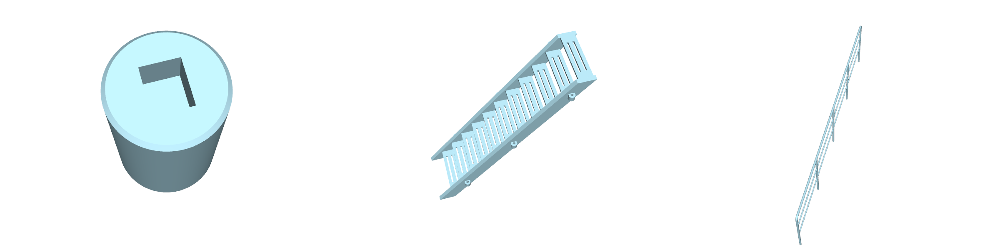

# M0-Bericht: Machbarkeit build123d / build123d-mcp

Stand 22.11.2026. Grundlage: `docs/konzept.md`, Abschnitt 8 (M0).
Alle Zahlen stammen aus Läufen in diesem Repository; die Rohdaten liegen in
`docs/m0/*.json`, die Skripte in `m0/`.

**Wichtig vorweg – Messrechner:** Gemessen wurde in einem Linux-Container
(x86_64, 4 Kerne, 15 GB RAM, Python 3.12.3), **nicht** auf deinem Mac mit
Apple Silicon. Die Zeiten sind also Richtwerte. Wiederholen auf dem Mac:
`uv run python m0/hole_step.py && uv run python m0/messen.py --wdh 5`.

Versionen: build123d 0.13.0, OCP 8.0.1.1 (**OCCT 8.0.1**), build123d-mcp 0.3.91.

## 1. Abnahme M0 – Ergebnis

Jede Messung läuft in einem frisch gestarteten Arbeitsprozess (spawn) mit
harter Zeitgrenze (120 s); der Hauptprozess importiert build123d nie.
5 Wiederholungen, angegeben ist der Median (Maximum in Klammern).

| Kriterium | Soll | Gemessen | Erfüllt |
|---|---|---|---|
| Alle drei Teile entstehen | ja | ja, alle gültig (`is_valid`), Treppe und Kransäule je 1 Körper, Reling 6 Drahtkörper bzw. 1 verschmolzener | ja |
| Volumen < 1 % gegen Abschnitt 10 | < 1 % | Treppe **−19,5 %** gegen Fusion; nicht prüfbar, siehe 1.1 | **nein / nicht prüfbar** |
| Volumen gegen analytische Formel derselben Geometrie | – | Kransäule 0,000 %, Treppe 0,000 %, Reling 0,000 % (Abweichung < 1e-12) | ja |
| Bauzeit je Teil | < 5 s | Kransäule 0,013 s (0,018), Treppe 0,675 s (0,723), Reling 0,028 s (0,029), Reling verschmolzen 0,150 s (0,164) | ja |
| STEP-Import | < 60 s | NIST CTC 02 (1,15 MB, 664 Flächen): 0,42 s (0,45); Rumpf GPPH (0,35 MB, 17 B-Spline-Flächen): 0,23 s (0,26); synthetisch 10 × CTC 02 (35,9 MB, 6.640 Flächen): 6,11 s (6,15) | ja |
| STEP aus dem Zwischenspeicher | < 2 s | BREP lesen: 0,015 s / 0,007 s / 0,154 s | ja |
| Abstand, Durchdringung, Strahl auf Fläche | messen | alle drei an allen drei STEP-Körpern gemessen, siehe 1.3 | ja |

**Dazu kommt, was die Kriterien nicht abdecken:** `import build123d` kostet in
jedem neuen Prozess **1,62–1,74 s** (Median über alle Läufe). Ein ganzer
Prozesslauf für ein Teil dauert deshalb 2,1–3,5 s, obwohl das Bauen selbst nur
0,01–0,7 s braucht. Folge für die Architektur: Abschnitt 2.2 verlangt „jeder Lauf
im eigenen Prozess“. Das geht nur mit **vorgewärmten Arbeitsprozessen**, die
build123d schon geladen haben, sonst kostet jede Mausaktion (7a) mindestens 1,7 s.

### 1.1 Annahme des Konzepts, die nicht hält: „Volumen < 1 % gegen Abschnitt 10“

Abschnitt 10 legt die Geometrie nicht vollständig fest. Für die Treppe fehlen
Stufentiefe, Stufendicke, Schlitzlänge, Lage und Grösse der Pfostenaugen und die
Lesart von „Wange 1,6 × 5 mm“ (5 mm quer zur Neigung oder senkrecht). Ich habe
diese Masse als `ANNAHME` gesetzt (`m0/teile.py`, jede Konstante ist markiert)
und komme auf 1.955,32 mm³ statt 2.428,5 mm³ (**−19,5 %**). Durch Drehen an den
freien Massen liesse sich jede Zahl erreichen; das wäre kein Nachweis, sondern
Anpassen.

Bei der Reling widersprechen sich die Vergleichswerte selbst: 2,8 m Ø 0,8 und
2,4 m Ø 0,5 ergeben nach Kreisfläche × Länge 1,878 cm³, angegeben sind 1,841 cm³
(+2,0 %). „Rund“ 2,8 m ist für eine 1-%-Prüfung zu ungenau. Für die Kransäule
nennt Abschnitt 10 selbst kein Volumen.

**Vorschlag:**
1. Die Genauigkeit des Kerns prüfe ich gegen eine **analytische Formel
   derselben Geometrie** (`*_soll_volumen` in `m0/teile.py`). Ergebnis: Abweichung
   0,000 % bei allen drei Teilen. Das ist die eigentliche Aussage „der Kern rechnet
   richtig“.
2. Für den Abgleich mit Fusion **die Fusion-Körper als STEP exportieren**
   (Treppe, Kransäule, acht Drähte). Werft vergleicht dann Form gegen Form:
   Volumen, Hülle und grösste Abweichung, statt nur einer Summenzahl. Das ist
   auch der Kern des späteren Werkzeugs `vergleich`. Bis die STEP-Dateien
   vorliegen, gilt das Kriterium als **nicht prüfbar**, nicht als erfüllt.

### 1.2 Bauzeiten im Detail

| Teil | Flächen | Bau kalt | Bau warm | Prüfen (`is_valid` + Volumen) | ganzer Prozess |
|---|---|---|---|---|---|
| Kransäule | 13 | 0,013 s | 0,009 s | 0,002 s | 2,14 s |
| Treppe | 170 | 0,675 s | 0,625 s | 0,032 s | 3,48 s |
| Reling (6 Körper) | 22 | 0,028 s | 0,021 s | 0,003 s | 2,22 s |
| Reling verschmolzen | 21 | 0,150 s | 0,139 s | 0,019 s | 2,54 s |

Export (einmalig gemessen): STEP 0,007–0,048 s, STL 0,009–0,10 s, 3MF
0,03–0,36 s. Alle STL- und 3MF-Dateien sind dicht. Das habe ich unabhängig mit
trimesh und lib3mf geprüft, die Archive zusätzlich mit `unzip -t`. Das
Netzvolumen weicht 0,0005–0,045 % vom BREP-Volumen ab
(Tessellationstoleranz 0,01 mm).

### 1.3 STEP-Körper: Import, Zwischenspeicher, Messungen

**Ersatz vermerkt:** Ein STEP-Export des Schiffsrumpfs liegt nicht vor. Als
Ersatz dienen (`m0/hole_step.py` lädt sie, Prüfsummen dort):
- **NIST CTC 02**, öffentliches Prüfteil der US-Behörde NIST: 1,15 MB,
  664 Flächen, davon 94 B-Spline;
- **GPPH-Rumpf** aus dem öffentlichen Repository crayon-party/Hull-GNN: ein echter
  Schiffsrumpf mit 17 B-Spline-Flächen, 12,07 m lang;
- **synthetisch**: 10 verschobene Kopien von CTC 02 in einer Datei, 35,9 MB,
  6.640 Flächen, als Lasttest.

| | CTC 02 | Rumpf | 10 × CTC 02 |
|---|---|---|---|
| STEP lesen | 0,420 s | 0,230 s | 6,113 s |
| BREP schreiben (Zwischenspeicher) | 0,031 s | 0,021 s | 0,420 s |
| BREP lesen (Zwischenspeicher) | 0,015 s | 0,007 s | 0,154 s |
| Grösse BREP | 1,46 MB | 1,19 MB | 15,8 MB |
| Abstand zu Nachbarquader | 0,032 s → 104,202 mm | 0,157 s → 558,091 mm | 0,074 s → 157,629 mm |
| Durchdringung (Bool-Schnitt mit Störquader) | 0,088 s, 222.781 mm³ | 0,128 s, 8,80e8 mm³ | 0,862 s, 4,34e7 mm³ |
| Strahl von oben, Treffer auf Flächen | 0,012 s, 2 Treffer | 0,027 s, 2 Treffer (Deck z = 1658,607, Boden z = 0,000) | 0,022 s, 0 Treffer (Strahl in der Lücke zwischen Kopien, richtig) |

**Unabhängig nachgeprüft:** Den Abstand habe ich zusätzlich an einem Netz mit
dichter Stichprobe nachgemessen (trimesh + scipy, kein OCCT). Ergebnis
104,491 mm statt 104,202 mm (+0,28 %) und 559,284 mm statt 558,091 mm (+0,21 %).
Eine Stichprobe kann den Abstand nur überschätzen, die Werte passen also. Alle
Volumina nach dem Lesen aus dem Zwischenspeicher sind bitgenau gleich denen nach
dem STEP-Import (Abweichung < 1e-12 relativ).

## 2. build123d-mcp: was es kann

Ausprobiert über einen echten MCP-Client (`m0/mcp_probe.py`, Protokoll in
`docs/m0/m0_mcp_probe.json`, Werkzeugliste in `m0/mcp_tools.txt`). Server
startet und meldet sich in 0,55 s, bietet **48 Werkzeuge**.

Funktioniert nachweislich:
- `execute`: freier build123d-Code in einer bleibenden Sitzung. Der Code läuft
  in einem Arbeitsprozess mit Sandkasten (AST-Prüfung, Import-Erlaubnisliste) und
  Zeitgrenze (`--exec-timeout`). Kransäule gebaut in 1,67 s inklusive
  Sitzungsaufbau.
- `measure` (0,01 s), `validate` (0,04 s, „Validity gate: PASS“ inklusive
  Dichtheitsprüfung), `analyze_printability` (0,02 s: meldet bei der Kransäule
  richtig die 100,5 mm² grosse waagrechte Unterseite neben dem Zapfen als
  Überhang), `cross_sections`, `compare` (fit/align/shape/snapshot),
  Merkmalserkennung (Bohrungen, Naben, Senkungen), Schnappschüsse.
- `render_view`: PNG kopflos über VTK in 2,4–3,2 s, mit Schnittebene
  (`clip_plane`), Farben und Hervorhebungen.
- `export`: STEP, STL, **3MF**, DXF, SVG (2,29 s für die Kransäule als STEP).
- `import_cad_file`: CTC 02 in 0,90 s.
- Live-Viewer: Netze gehen als glb über einen Unix-Socket an eine
  Betrachter-Anwendung (`viewer.py`). Das ist für die App interessant.
- Fertige Anleitungen für Agenten (`install_skill`, Kochbücher für Selektoren).

Beobachtete Schwächen:
- **Der Dienst blockiert während einer Rechnung.** Messung: Während einer
  Endlosschleife in `execute` antwortete `health_check` erst nach **13,30 s**,
  nämlich erst nach dem Abbruch an der Zeitgrenze (15 s). Alle Werkzeugaufrufe
  laufen über eine Sperre an einer einzigen Sitzung. Genau das ist
  Fusion-Problem 2 aus Abschnitt 2.2.
- **Eine Zeitüberschreitung im Elternprozess tötet die ganze Sitzung.** Das
  steht im Quelltext (`worker.py`, Kommentar zu Issue #214: „a timeout here kills
  the worker and destroys all session state“). Im Versuch blieb die Sitzung
  erhalten, weil die Python-Schleife per SIGALRM unterbrechbar war; eine
  hängende OCCT-Rechnung in C++ ist das nicht.
- **Speichergrenze auf dem Mac wirkungslos**: `RLIMIT_DATA` ist unter macOS
  laut eigenem Quelltextkommentar ein „documented no-op“.
- Die Standard-Iso-Ansicht von `render_view` zeigte die Tasche oben in der
  Kransäule nicht; mit ausdrücklich gesetztem `azimuth`/`elevation` war sie
  sichtbar (`docs/m0/probeteile.png`). Die Ursache habe ich nicht geklärt.
  Folgerung: Werft rendert nur mit festen, benannten Kameras.
- Grösse und Tempo: rund 21.800 Zeilen in Version 0.3.x, viel davon für
  Zeichnungen (Nicht-Ziel). Antworten sind gemischt Text und JSON.

## 3. Was fehlt gegenüber Abschnitt 6, 6a und 7a

| Konzept | build123d-mcp | Lücke |
|---|---|---|
| `projekt_status` | `session_state` (nur die Sitzung) | Projektordner, Git-Stand, Aufträge fehlen |
| `bauen(teile, warten_s)` | – | Projekt mit `parts/*.py`, Baugraph und Zwischenspeicher fehlen ganz |
| `auftrag(id, …)` | – | Keine Hintergrundaufträge; Aufrufe blockieren (13,3 s gemessen) |
| `ausfuehren(code)` | `execute` | vorhanden, aber Sitzung mit Zustand statt Wegwerf-Sitzung |
| `messen(abstand/durchdringung/strahl/masse/huelle)` | `measure`, `compare(kind="fit")`, `clearance()` im Code | Strahl fehlt als Werkzeug |
| `rendern(…)` | `render_view` | vorhanden; benannte Ansichten (`views.toml`) fehlen |
| `foto_abgleich` | – | fehlt |
| `pruefen` (pytest) | `validate`, `inspect_part` | pytest-Prüfungen des Projekts fehlen |
| `druck_analyse` | `analyze_printability` | weitgehend vorhanden (Überhang, Wand, Bett) |
| `vergleich(stand_a, stand_b)` | `compare(kind="shape")` in der Sitzung | Vergleich zweier Git-Stände fehlt |
| `export(…, drucklage)` | `export` inkl. 3MF | Drucklage fehlt |
| `anmerkungen`, `stand_sichern` | – | fehlt |
| Antwortformat `{ok, dauer_s, warnungen, ergebnis}` | gemischt | fehlt |
| 6a Bildmessung (alle 8 Bausteine) | – | fehlt vollständig, kein OpenCV |
| 7a Maus-Bedienung | Live-Viewer nur zum Ansehen | fehlt vollständig |

## 4. Empfehlung: **nur Vorbild** für den Kern, daneben unverändert verwenden

Begründung:
1. Die tragenden Forderungen aus Abschnitt 2.2 und 4 widersprechen dem Aufbau
   von build123d-mcp: eine Sitzung mit Zustand und Sperre statt Aufträge und
   Warteschlange (gemessen: 13,3 s blockiert), Sitzungsverlust bei
   Zeitüberschreitung, kein Projekt, kein Baugraph, kein Zwischenspeicher. Das
   nachzurüsten hiesse, den Kern umzubauen. „Erweitern“ wäre also ein Fork von
   21.800 Zeilen in einer Version 0.3, die sich schnell bewegt. Das widerspricht
   Vorrang (a), dem kleinen Aufwand.
2. Was Werft wirklich neu braucht (werftd, Baugraph, Cache, Aufträge, Projekt),
   ist überschaubar. Die Geometrie macht ohnehin build123d.
3. Gute Ideen übernehmen wir ausdrücklich: Arbeitsprozess plus Sandkasten mit
   Import-Erlaubnisliste, Gültigkeits-Tor vor dem Export, Hinweise zur Reparatur
   in Fehlermeldungen, glb-Strom für den Betrachter, Druckanalyse.
4. **Unverändert verwenden** ist trotzdem sinnvoll: Als zweiter MCP-Server
   neben dem Werft-Server kann der Agent damit heute schon frei skizzieren,
   rendern und messen. Das kostet nichts. Werft ruft build123d-mcp aber nicht
   intern auf.

Rückfallebene: Erweist sich eigene Druckanalyse oder eigenes Rendern als teuer,
können die Funktionen von build123d-mcp (Apache-2.0) als **Bibliothek** in
unseren Arbeitsprozessen aufgerufen werden, nicht als Server.

## 5. Gefundene Schwächen des Geometriekerns

Probe: `m0/schwaechen.py`, Daten in `docs/m0/m0_schwaechen.json`. Jeder Fall
läuft im eigenen Prozess mit 90 s Grenze.

| Fall | Ergebnis | Bewertung |
|---|---|---|
| Alle 24 Kanten der Kransäule runden, r = 0,2 | gültig | gut |
| Durchdringungskanten der verschmolzenen Reling runden (26 Kanten, r = 0,15) | gültig | gut, besser als erwartet |
| Stufenkanten der Treppe runden (r = 0,2) | **Fehler** „Failed creating a fillet … try a smaller value“ | Meldung nennt die schuldige Kante nicht |
| Schale des Freiform-Rumpfs (STEP), Deck offen, Wand 20 mm | **Fehler** „offset Error“ bei allen drei Offset-Arten | Schale an Freiform scheitert |
| Schale eines Loft-Rumpfs (Ellipsenspanten), Wand 1,2 mm | **Fehler** „offset Error“ | wie oben |
| Schale eines am Deck eben abgeschnittenen Loft-Rumpfs | **stiller Fehler**: `Kind.ARC` liefert einen „gültigen“ Körper mit Volumen 8,5e-14 mm³; `Kind.INTERSECTION` gibt den Körper **unverändert** zurück (89.996 mm³ vorher wie nachher), ebenfalls „gültig“ | **gefährlich**: `is_valid` sagt nichts über das Ergebnis |
| Ausweichbauweise: Aussen-Loft minus Innen-Loft | gültig in 0,15 s; der Strahl misst die Bodenwand mit 1,200 mm (z −22,0 / −20,8) | funktioniert |
| Rohr Ø 0,8 mit Biegeradius 0,3 (kleiner als Rohrradius) | „gültig“, Volumen 9,988 mm³, obwohl sich das Rohr selbst durchdringt | Kern merkt Selbstdurchdringung nicht |
| Radius 0,8 an Platte 1 mm dick | sauberer Fehler mit Hinweis auf `max_fillet()` | gut |
| 200 Bohrungen einzeln abgezogen / in einem Aufruf | 5,96 s / 0,30 s, beide Volumen exakt (Abweichung 7e-13 %) | einzelne Bool-Operationen in Schleifen sind 20 × langsamer |
| `Solid & Axis` | liefert die Strecke im Körper als Kante, keine Trefferpunkte | API-Falle; Strahl über Flächen schneiden |
| STL eines importierten STEP-Körpers (CTC 02, Rumpf) | Netz **nicht dicht** (trimesh), eigene Teile dicht | vor dem Druck-Export importierter Körper prüfen; Ursache offen |

Folgerungen für die Hilfsbibliothek (`lib/`):
- Nach jeder Operation eine **Plausibilitätsprüfung**: Volumen > 0, Vorzeichen
  und Grössenordnung der Volumenänderung passen zur Operation. Eine Schale muss
  das Volumen deutlich verringern, darf es aber nicht auf null bringen.
  `is_valid` allein reicht nicht.
- `schale()` für Rümpfe als **Loft-Differenz**, nicht über `offset`.
- `draht()` prüft Biegeradius ≥ Drahtradius (und ≥ 1,5 mm nach Abschnitt 10)
  als Parameterregel, bevor gebaut wird.
- Bool-Operationen gesammelt ausführen (`a - [b1, b2, …]`).
- Strahl-Helfer, der Trefferpunkte sortiert liefert (wie in `m0/messen.py`).
- Bei gescheiterter Verrundung die Kanten einzeln probieren und die schuldige
  melden.

## 6. Annahmen des Konzepts, die ich ändern würde

1. **„Volumen < 1 % gegen Abschnitt 10“**: nicht prüfbar (1.1). Ersetzen durch
   „0,0 % gegen analytische Formel“ plus Formvergleich gegen STEP-Exporte aus
   Fusion.
2. **„Jeder Lauf im eigenen Prozess“**: richtig, aber nur mit vorgewärmten
   Prozessen bezahlbar (1,7 s Import je Prozess). Ins Konzept: Pool aus warmen
   Arbeitsprozessen; ein Prozess wird nach Zeitüberschreitung oder Absturz
   ersetzt, nicht wiederverwendet.
3. **„Speichergrenze“ auf dem Mac**: `setrlimit` wirkt dort nicht verlässlich
   (Quelltextkommentar in build123d-mcp). Stattdessen überwacht werftd den
   Speicherverbrauch (RSS) der Prozesse und beendet sie bei Überschreitung.
4. **Mac-App in SwiftUI ab M5**: Es gibt schon eine native App, QOOB3D, mit
   Fusion-Navigation, Skizzen, Extrudieren/Drehen/Loft, Druckbett und
   3MF-Export. Vorschlag in Abschnitt 8. Ob es so kommt, entscheidest du.

## 7. Überarbeiteter Plan M1–M3

Grundsätze: Python-Paket `werft` in diesem Ordner, Tests mit pytest,
Messzahlen in jedem Abnahmetest.

**M1 – Kern und CLI**
1. Projektformat: `werft.toml`, `soll/*.json` mit Pflichtfeldern
   `id, wert, quelle, status` (Prüfung beim Laden, Annahmenbericht).
2. `@teil(...)`-Dekorator und `soll()`, das jeden Zugriff protokolliert.
   Abhängigkeiten: ausdrücklich über Parameter (`dep`) **plus** automatisch aus
   den Importen von `lib/` (AST).
3. Baugraph und Zwischenspeicher. Schlüssel = Hash aus Teilcode, transitiv
   genutzten `lib/`-Dateien, gelesenen Sollwerten, Eingangsdateien (STEP) und
   build123d-Version. Abgelegt als BREP plus Metadaten-JSON in
   `.werft/cache/` (gemessen: Lesen 7–154 ms).
4. werftd: asyncio-Dienst auf localhost, rechnet nie selbst. Pool von N warmen
   Arbeitsprozessen; je Auftrag Zeitgrenze, RSS-Grenze, Abbruch;
   Auftragskennung mit Status.
5. CLI `werft status | bauen | auftrag | export`, startet werftd bei Bedarf.
6. Hilfsbibliothek mit den Regeln aus Abschnitt 5 (Plausibilität, `draht`,
   `zapfen`/`loch` mit Spiel, `schale`, `strahl`).
7. Abnahme als pytest: Ein endloses Teil wird nach der Zeitgrenze beendet, und
   `status` antwortet währenddessen in < 100 ms. Ein geändertes Teil baut genau
   sich und seine Abhängigen neu (gezählt). Zusätzlich: Ein Neubau aus dem
   Zwischenspeicher dauert < 0,2 s.

**M2 – MCP-Server**
Dünne Hülle (offizielles `mcp`-Paket, stdio) um dieselben Funktionen wie die
CLI. Werkzeuge aus Abschnitt 6 ohne Foto/Druck. Antwortformat einheitlich
`{ok, dauer_s, warnungen, ergebnis}`, Listen gekürzt mit Zähler.
`ausfuehren` läuft in einem Wegwerf-Prozess aus dem Pool. `vergleich` baut
einen Git-Stand in einem temporären Worktree. `stand_sichern` committet nur bei
grünem pytest. Abnahme: Ein frischer Agent ohne Vorwissen baut nur über MCP eine
Kiste mit Deckel und Zapfenverbindung samt Prüfung. Das lässt sich hier mit
einem Sub-Agenten nachstellen.

**M3 – Rendern und Foto-Abgleich**
Kopfloses Rendern mit VTK offscreen (ist schon installiert), nur benannte
Kameras aus `views.toml`, Schnittebene als Parameter. Foto-Abgleich: Kamera aus
6a, Modellumriss in dieselbe Kamera projizieren, Abweichung in px und mm.

## 8. Strang Bildmessung (6a): Plan

Kernidee für die Prüfbarkeit: **Synthetische Fotos mit bekannter Wahrheit.**
Werft rendert ein bekanntes Modell (z. B. die Kransäule) mit bekannter Kamera,
optional mit Bildrauschen und Linsenverzeichnung. Jeder Baustein muss diese
Kamera bzw. diese Punkte wiederfinden. Der Fehler in px und mm ist dann exakt
messbar, bevor echte Fotos kommen.

| Schritt | Baustein | Verfahren | Abnahme mit synthetischen Fotos |
|---|---|---|---|
| B1 | Kameramodell, Datei `fotos/cam_*.json` | Lochkamera + Brown-Verzeichnung | Laden/Speichern, Projektion gegen VTK-Bild < 0,5 px |
| B2 | Kamera einmessen | `cv2.solvePnP` + Ausgleich (`scipy.optimize.least_squares`), Kovarianz → Unsicherheit | ≥ 6 Passpunkte, Restfehler < 0,5 px; Warnung bei fast ebenen Passpunkten |
| B3 | Punkt triangulieren | lineare Triangulation + Ausgleich, Unsicherheit aus Kovarianz; Schnittwinkel-Warnung < 5° | Fehler < Unsicherheitsangabe in 95 % der Fälle |
| B4 | Punkt auf bekannter Fläche | Sehstrahl → Kern-Strahl (`strahl()` aus M1) | Fehler < 0,1 mm am synthetischen Modell |
| B5 | Ebene entzerren | Homographie (`cv2.findHomography`), Orthobild mit mm-Massstab | Massstab-Fehler < 0,5 % |
| B6 | Umrissvergleich | Silhouette des Modells aus derselben Kamera gegen Kantenbild des Fotos (Distanztransformation) | mittlere Abweichung in px und mm |
| B7 | Kamera aus Fluchtpunkten | drei Fluchtpunkte, eine bekannte Strecke | Winkelfehler < 1° |
| B8 | Profil aus Foto | Umriss eines Drehteils, Ellipsen-Anpassung | Durchmesser-Fehler < 1 % |
| B9 (optional) | dichte Rekonstruktion | COLMAP als Hintergrundauftrag | nur bei Bedarf |

Jeder Wert wird mit Herkunft (Foto, Pixel, Verfahren), Restfehler und Status in
`soll/*.json` geschrieben. Für B1–B5 braucht es nur OpenCV, NumPy und SciPy.
Danach kommen echte Drohnenfotos des Schiffs als Probe (Erfahrungswert
±1–2 mm).

## 9. Maus-Bedienung (7a) und QOOB3D

Laut deiner Antwort ist dein früheres, von Claude gebautes CAD-Programm
**QOOB3D** (dieses Repository). Angesehen habe ich `docs/architecture.md`,
`docs/design/controls.md` und `docs/requirements/sketches.md`. Vorhanden sind:

- Rust/egui-App mit OCCT 7.8.1: Navigation wie Fusion (Orbit um den Punkt
  unter dem Cursor, ViewCube, Trackpad-Gesten);
- Skizzen auf XY/XZ/YZ und Versatzebenen: Linie, Rechteck, Kreis, Bogen,
  Werte-HUD mit Ausdrücken (`10+5`, `1in`), Fang, Auswahl und Ziehen;
- Extrudieren, Drehen, Loft, Zahnrad, Feder mit Live-Vorschau;
  Rückgängig/Wiederholen; 441 Druckerprofile mit Druckbett; STL/3MF-Export;
- ein starker Qualitätsrahmen (ADRs, xtask-Prüfungen, Rollen für Agenten).

Das deckt einen grossen Teil der ersten Stufe von 7a ab: Skizze, Masse
eintippen, Fang, Extrudieren und Drehen. Es fehlen Grundkörper mit Griffen,
Bool-Auswahl, Runden/Fasen, Wandstärke, Bohrung, Zapfen-Loch und
Fotounterlage.

**Der Grundkonflikt:** 7a verlangt „jeder Handgriff schreibt eine Zeile Code,
kein zweiter Datenbestand“. QOOB3D speichert ein eigenes `.qbd`-Dokument mit
Feature-Liste.

**Vorschlag (Entscheidung bei dir):** QOOB3D wird die Werft-App und ersetzt
die neue SwiftUI-App.
1. Die Ansicht holt Netze von werftd (glb über WebSocket) statt aus dem
   eigenen Kern. So ist sie Betrachter für alles, was der Agent baut, mit
   Teilebaum, Schnitt und Messen.
2. Die Skizzen- und Feature-Werkzeuge erzeugen **build123d-Code** in
   `parts/*.py` (z. B. Extrudieren → `extrude(skizze, amount=…)`), statt
   `.qbd`-Features. Die Live-Vorschau kommt aus einem warmen Arbeitsprozess.
   Gemessen: Kransäule 0,009 s, Treppe 0,63 s Bauzeit.
3. Der eigene OCCT-Kern in Rust bleibt zunächst für Skizzenprofile und schnelle
   Vorschau, wird aber nicht mehr zur Quelle der Wahrheit.

Vorteil: Kein zweites App-Projekt, Navigation und Skizzen sind fertig und
getestet. Nachteil: Rust/egui statt SwiftUI, und der Qualitätsrahmen von
QOOB3D ist für „Aufwand klein halten“ schwer. Bevor ich 7a im Detail plane,
brauche ich deine Entscheidung zu diesem Punkt.

## 10. Offene Punkte

- STEP-Exporte der Fusion-Körper (Treppe, Kransäule, acht Drähte) für den
  echten Vergleich (1.1).
- Wiederholung der Messung auf dem Mac.
- Ursache: Iso-Render ohne Tasche; nicht dichtes STL importierter STEP-Körper.
- Repository-Regel ADR-0045 („alles Englisch“): `docs/konzept.md` und dieser
  Bericht sind deutsch. `cargo xtask hygiene` meldet 88 Zeilen in
  `docs/konzept.md`. Abhilfe: Ein Mensch trägt `path: werft/docs/` in
  `harness/language-allowlist.txt` ein; diese Datei darf ich nicht ändern. Der
  Code in `werft/` enthält keine Umlaute.
